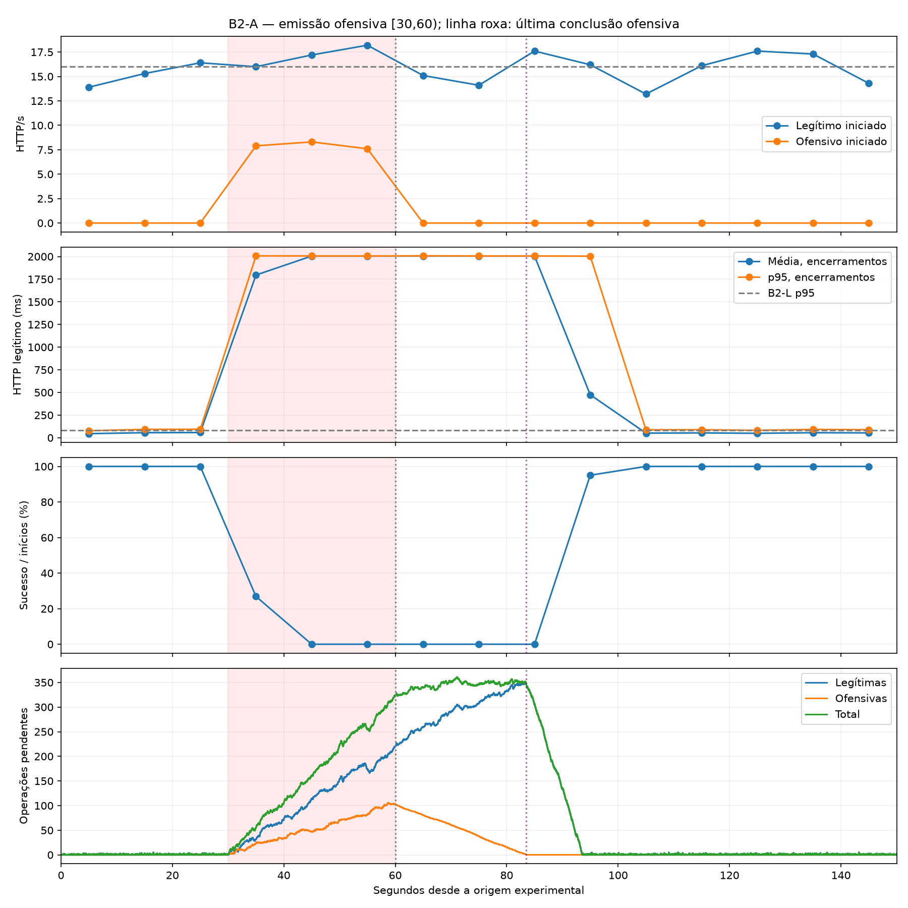
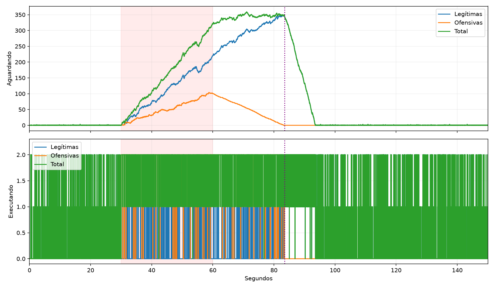

# B2-A — piloto combinado L2 + A3

**A3 coincidiu com forte perda de atendimento legítimo, formação sustentada de filas e efeitos prolongados após a emissão. A execução foi operacionalmente certificada e íntegra. Houve recuperação descritiva no final de P3; podemos avançar para B2-F como próximo piloto exploratório, preservando as ressalvas abaixo. B2-F não foi executada.**

## 1. Identificação, ambiente e procedimento

Run `18565197554746caa01170805ff5ea5a`; dataset `/home/henrique-givisiez/Documents/Faculdade/TCC/TCC/experiment_results/b2-a-20261107T234426Z/dataset`. Checkout `824afd685640e3102ae9e8276287480c290ea1c0`, branch refactor/project-organization, working tree limpo antes da preparação. Uma única execução; returncode 0; completed/simulation_end; certificado completed, outcome completed_with_http_degradation, cleanup_verified=true. A degradação HTTP não acionou interrupção. O certificado está vinculado ao manifesto SHA256 `9ac7c44b8deabb15715a10033f44754396b72e53649b674b8ad4c0273a69fb04`. Dataset válido e elegível; exportação após encerramento/limpeza. Não houve repetição, build/pull ou alteração do simulador.

Configuração específica configuration.json (cópia em experiment_results/.../config.json), derivada do template protegido original sem sobrescrevê-lo: somente ID e attack.rate=4 foram alterados. L2: duas fontes × 8 RPS, /medium, nominal 16 RPS durante 150 s. A3: duas fontes × 4 RPS, /expensive, nominal 8 RPS em [30,60), computational_asymmetry continuous. Uma vítima, topologia direta sem NGINX, dois workers, timeout 2 s para ambas as classes, concorrência configurada 64 por classe (32 por fonte), sem autoscaling/balanceamento. Kernel, work_units, instrumentação e monitoramento preservados da infraestrutura atual; seed 20261107. Captura TCP e diagnósticos ON.

Imagens idênticas à B2-L, verificadas contra arquivos/launcher do checkout no preflight:

- Vítima: `sha256:03a186aa90eec03b874c82a887b245e7190fa45cd7256af3c077cb64943d52b0`.
- Quatro fontes: `sha256:b94212edd4d31c34998aea870caebc4ba145c1593d1b8dfdc27fe4917719fe3e`.

Comparabilidade estrutural verificada em compatibility.json: normal_traffic, server, monitoring, diagnostics, topology, autoscaler, infrastructure, load_balancer, traffic_sources e política iguais à B2-L. Docker Engine 29.9.3, Python host 3.12.3; versões/pacotes, Docker info, imagens, recursos e comandos completos em initial_environment.json, image_inspect.json e command.json. Auditoria anterior: aproximadamente 10,5 GB RAM disponível, 37,5 GB disco livre e nenhum contêiner ativo. Host não foi tratado como ambiente de desempenho determinístico.

Política exploratory-offensive-v1 sem alteração: RAM mínima 2 GiB, disco mínimo 4 GiB, memória observada da vítima até 1 GiB e por fonte até 512 MiB, artefatos até 512 MiB, frescor da coleta 5 s, timeout Docker 3 s, orçamento global 240 s. São limites observacionais/proteções existentes, não quotas de CPU/RAM impostas. Foram reutilizados diagnostic_run, preflight e verificação de imagem, encadeamento --previous-run da B2-L, coleta, exportação, certificação e validação existentes. analyze.py apenas complementa offline o offensive_analysis v2, seus http_metrics/classify_operations e redutores de estado; não cria um novo coletor ou detector.

## 2. Emissão e atendimento HTTP

Coortes por instante de início HTTP: P1=[0,30), P2=[30,60), P3=[60,150). Resultados e duração incluem conclusões reais posteriores aos limites, mantendo a coorte original. Total legítimo usa [0,150)/150 s; Total ofensivo usa inícios em [30,60)/30 s, sem diluir a taxa por 150 s.

| Classe | Coorte | Nominal / iniciado RPS | Submissões | Inícios | Respostas / 2xx | Timeouts | Sucessos/inícios |
|---|---|---|---|---|---|---|---|
| benign | Total | 16.00 / 15.900 | 2385 | 2385 | 1438 / 1438 | 947 | 1438/2385 (60.29%) |
| benign | P1 | 16.00 / 15.200 | 456 | 456 | 456 / 456 | 0 | 456/456 (100.00%) |
| benign | P2 | 16.00 / 17.133 | 514 | 514 | 43 / 43 | 471 | 43/514 (8.37%) |
| benign | P3 | 16.00 / 15.722 | 1415 | 1415 | 939 / 939 | 476 | 939/1415 (66.36%) |
| attack | Total | 8.00 / 7.933 | 238 | 238 | 16 / 16 | 222 | 16/238 (6.72%) |
| attack | P1 | 0.00 / 0.000 | 0 | 0 | 0 / 0 | 0 | 0/0; N/D |
| attack | P2 | 8.00 / 7.933 | 238 | 238 | 16 / 16 | 222 | 16/238 (6.72%) |
| attack | P3 | 0.00 / 0.000 | 0 | 0 | 0 / 0 | 0 | 0/0; N/D |

Todos os inícios têm encerramento conhecido. Erros HTTP, erros de conexão e tentativas sem encerramento observado: zero em ambas as classes e períodos. Todos os códigos recebidos são 200. Legítimos: 2.385 submissões/inícios, nenhuma expiração pré-HTTP, disponibilidade 1.438/2.385=60,2935%. Ofensivos: 238 admissões, submissões e inícios, nenhuma expiração/rejeição pré-HTTP, 16 respostas e 222 timeouts. Admissões legítimas não têm evento independente: N/D, não zero. O journal ofensivo e os diagnósticos das quatro fontes foram reconciliados com os logs HTTP; planos sem submissão são preservados em emission_reconciliation.json e não são falhas de atendimento.

A taxa legítima iniciada em P2 foi 17,133 RPS, próxima/acima do nominal e sem evidência de colapso de emissão. Entretanto a taxa de respostas bem-sucedidas da coorte foi apenas 43/30=1,433 RPS, com disponibilidade 8,3658%. Essas taxas têm significados diferentes: emissão preservada não equivale a atendimento preservado. A taxa ofensiva realizada foi 7,933 RPS contra 8 nominais (238 contra 240 esperadas por nominal × janela). Não houve início ofensivo fora de [30,60).

Não houve tentativa legítima iniciada após 150 s nesta execução. Tentativas que começaram antes do limite e concluíram após ele permanecem em P3; IDs em summary.json/boundary_crossings e tempos reais em http_attempts.csv. Nenhuma conclusão em P3 reclassifica uma tentativa iniciada em P2.

## 3. Duração HTTP e separação entre encerramento e resposta

| Classe | Coorte | Encerramentos: média / mediana / p95 ms | Respostas: média / mediana / p95 ms |
|---|---|---|---|
| benign | Total | 871.32 / 81.24 / 2006.04 | 124.54 / 46.19 / 669.72 |
| benign | P1 | 53.27 / 45.28 / 90.08 | 53.27 / 45.28 / 90.08 |
| benign | P2 | 1939.93 / 2005.02 / 2006.48 | 1224.78 / 1040.97 / 1990.32 |
| benign | P3 | 746.78 / 74.27 / 2006.02 | 108.77 / 45.80 / 272.08 |
| attack | Total | 1943.39 / 2005.06 / 2006.73 | 1085.75 / 935.77 / 1911.70 |
| attack | P1 | N/D / N/D / N/D | N/D / N/D / N/D |
| attack | P2 | 1943.39 / 2005.06 / 2006.73 | 1085.75 / 935.77 / 1911.70 |
| attack | P3 | N/D / N/D / N/D | N/D / N/D / N/D |

Encerramentos incluem timeouts de aproximadamente 2 s; não são uma distribuição só de respostas. Os tempos de resposta somente dos sobreviventes são condicionais ao recebimento de resposta e não representam todos os inícios. Nenhuma duração foi imputada. Mediana convencional; p95 por posto mais próximo, usando as rotinas existentes. Mínimo/máximo e denominadores completos em http_by_period.csv/summary.json.

## 4. Operações computacionais e workers

| Classe | Coorte HTTP | Subm./inic./concl./falha | CPU/op ms | Parede/op ms | Espera média / mediana / p95 ms |
|---|---|---|---|---|---|
| benign | Total | 2385 / 2385 / 2385 / 0 | 36.25 | 36.34 | 5014.71 / 2.72 / 21261.59 |
| benign | P1 | 456 / 456 / 456 / 0 | 35.27 | 35.40 | 3.16 / 1.23 / 18.35 |
| benign | P2 | 514 / 514 / 514 / 0 | 37.76 | 37.78 | 11876.92 / 10704.93 / 23183.25 |
| benign | P3 | 1415 / 1415 / 1415 / 0 | 36.01 | 36.13 | 4137.04 / 1.55 / 20152.39 |
| attack | Total | 238 / 238 / 238 / 0 | 364.68 | 365.55 | 11342.55 / 10646.49 / 22451.21 |
| attack | P1 | 0 / 0 / 0 / 0 | N/D | N/D | N/D / N/D / N/D |
| attack | P2 | 238 / 238 / 238 / 0 | 364.68 | 365.55 | 11342.55 / 10646.49 / 22451.21 |
| attack | P3 | 0 / 0 / 0 / 0 | N/D | N/D | N/D / N/D / N/D |

Todas as 2.385 operações legítimas e 238 ofensivas terminaram computacionalmente, inclusive as associadas a timeouts HTTP. Timeout no cliente não representa cancelamento do trabalho já recebido: esse trabalho permaneceu na fila e disputou os dois workers. Essa distinção explica 2.385 conclusões computacionais legítimas contra apenas 1.438 respostas HTTP recebidas. As métricas computacionais das coortes acompanham o início HTTP; computational_events_by_actual_time.json preserva também o instante real de cada evento por período.

| Classe | Coorte | PID | Operações | Espera média / mediana / p95 ms |
|---|---|---|---|---|
| benign | Total | 25 | 1208 | 4991.91 / 7.07 / 21148.77 |
| benign | Total | 26 | 1177 | 5038.11 / 2.27 / 21306.64 |
| benign | P1 | 25 | 229 | 3.51 / 1.23 / 20.28 |
| benign | P1 | 26 | 227 | 2.80 / 1.23 / 16.79 |
| benign | P2 | 25 | 266 | 11417.23 / 10547.89 / 22887.64 |
| benign | P2 | 26 | 248 | 12369.98 / 11317.24 / 23200.08 |
| benign | P3 | 25 | 713 | 4196.97 / 1.57 / 20216.66 |
| benign | P3 | 26 | 702 | 4076.17 / 1.53 / 20047.74 |
| attack | Total | 25 | 121 | 11380.83 / 10725.41 / 22206.39 |
| attack | Total | 26 | 117 | 11302.97 / 10562.10 / 22451.21 |
| attack | P2 | 25 | 121 | 11380.83 / 10725.41 / 22206.39 |
| attack | P2 | 26 | 117 | 11302.97 / 10562.10 / 22451.21 |

A espera entre work_submitted e work_started inclui fila, IPC e agendamento; a duração computacional e CPU/op são os campos emitidos pelos workers. Os PIDs identificam os processos nesta execução, não identidades estáveis entre execuções. Operações unknown de auditoria estão separadas e não entram nas distribuições acima.

## 5. Filas, residual e recuperação

| Intervalo | Classe | Pico aguardando | Pico executando | Pico pendente |
|---|---|---|---|---|
| Total | benign | 350 | 2 | 351 |
| Total | attack | 104 | 2 | 106 |
| Total | total | 359 | 2 | 361 |
| P1 | benign | 3 | 2 | 5 |
| P1 | attack | 0 | 0 | 0 |
| P1 | total | 3 | 2 | 5 |
| P2 | benign | 220 | 2 | 220 |
| P2 | attack | 104 | 2 | 106 |
| P2 | total | 322 | 2 | 324 |
| P3 | benign | 350 | 2 | 351 |
| P3 | attack | 101 | 2 | 103 |
| P3 | total | 359 | 2 | 361 |

Os máximos por classe podem ocorrer em instantes diferentes e não devem ser somados. O pico agregado foi 359 aguardando e 361 pendentes, maior já em P3; instantes exatos em queue_peak_times.json. queue_transitions.csv contém todas as transições observadas, sem reduzir o diagnóstico a amostras de um segundo. existing_analyzer/timeseries.csv preserva bins de eventos e estados no limite esquerdo do término de cada segundo.

| Instante− | Legítimas aguard./exec./pend. | Ofensivas aguard./exec./pend. | Total pendente |
|---|---|---|---|
| 30 s | 0 / 1 / 1 | 0 / 0 / 0 | 1 |
| 60 s | 220 / 0 / 220 | 101 / 2 / 103 | 323 |
| 70 s | 290 / 0 / 290 | 59 / 2 / 61 | 351 |
| 80 s | 333 / 0 / 333 | 14 / 2 / 16 | 349 |
| 90 s | 133 / 2 / 135 | 0 / 0 / 0 | 135 |
| 120 s | 0 / 0 / 0 | 0 / 0 / 0 | 0 |
| 150 s | 0 / 2 / 2 | 0 / 0 / 0 | 2 |

Em 60− s havia 220 legítimas aguardando e 103 ofensivas pendentes (101 aguardando + 2 executando), total 323. O estado em 60 s após os eventos exatamente na fronteira é igual ao anterior: nenhum evento ocorreu exatamente no corte; ambos os snapshots foram preservados. Todas as 238 operações ofensivas foram submetidas antes de 60 s; 103 concluíram a partir de 60 s. A última terminou em 83.482269 s, isto é, 23.482269 s após o fim da emissão. Isso mede a drenagem observada das operações ofensivas identificadas, não uma garantia universal contra ingressos não observados.

A fila legítima continuou aumentando durante o residual ofensivo, mesmo sem novos inícios ofensivos. Após 83.482 s não restavam operações ofensivas, mas ainda havia trabalho legítimo acumulado: em 90− s eram 135 pendentes. O primeiro retorno do total pendente a zero após 60 s ocorreu em 93.567526 s. O último timeout legítimo iniciou em 90.562332 s e terminou em 92.567425 s. O atendimento pode voltar a caber no timeout antes de a fila inteira zerar; são marcos distintos. As operações não foram artificialmente canceladas ou drenadas por mudança da política.

## 6. Evolução em intervalos de 10 s

| Coorte legítima | Inícios/RPS | 2xx/inícios | HTTP média / p95 ms | Espera média ms | CPU/op ms |
|---|---|---|---|---|---|
| 0-10 | 139 / 13.90 | 139/139 | 45.56 / 77.13 | 1.81 | 30.46 |
| 10-20 | 153 / 15.30 | 153/153 | 55.77 / 92.18 | 4.02 | 35.87 |
| 20-30 | 164 / 16.40 | 164/164 | 57.48 / 93.81 | 3.49 | 38.80 |
| 30-40 | 160 / 16.00 | 43/160 | 1795.62 / 2007.23 | 3968.31 | 38.27 |
| 40-50 | 172 / 17.20 | 0/172 | 2005.16 / 2006.41 | 10915.22 | 37.11 |
| 50-60 | 182 / 18.20 | 0/182 | 2005.14 / 2006.25 | 19738.41 | 37.92 |
| 60-70 | 151 / 15.10 | 0/151 | 2005.70 / 2007.82 | 19815.93 | 39.30 |
| 70-80 | 141 / 14.10 | 0/141 | 2005.27 / 2006.30 | 12537.94 | 37.40 |
| 80-90 | 176 / 17.60 | 0/176 | 2005.22 / 2006.32 | 5790.90 | 37.82 |
| 90-100 | 162 / 16.20 | 154/162 | 474.32 / 2004.10 | 445.21 | 35.72 |
| 100-110 | 132 / 13.20 | 132/132 | 51.16 / 87.65 | 3.26 | 34.91 |
| 110-120 | 161 / 16.10 | 161/161 | 53.60 / 88.68 | 3.98 | 34.43 |
| 120-130 | 176 / 17.60 | 176/176 | 49.16 / 81.52 | 2.89 | 33.20 |
| 130-140 | 173 / 17.30 | 173/173 | 55.62 / 91.96 | 3.21 | 35.02 |
| 140-150 | 143 / 14.30 | 143/143 | 53.67 / 88.59 | 2.80 | 36.72 |

P3 não é homogêneo: [60,90) mantém 0% de respostas bem-sucedidas; [90,100) tem 154/162=95,06%; cada um dos cinco bins de [100,150) tem 100%. Agregando [100,150): 785/785 sucessos, 15.700 RPS, HTTP médio 52.65 ms, p95 87.77 ms, espera média 3.23 ms e CPU/op 34.78 ms. Essas medidas são próximas da referência interna P1 (53,27 ms de HTTP médio, 90,08 ms de p95, espera 3,16 ms). Há recuperação observada no final de P3; a média de todo P3 ainda reflete o período prolongado de degradação.

## 7. Comparação descritiva com B2-L e P1 interno

| Referência/coorte | RPS legítimo | Disponibilidade | HTTP média / p95 ms | Espera média ms | CPU/op ms |
|---|---|---|---|---|---|
| B2-L [0,150) | 15.9 | 100% | 46,87 / 79,71 | 2.68 | 29.82 |
| Total | 15.90 | 60.29% | 871.32 / 2006.04 | 5014.71 | 36.25 |
| P1 | 15.20 | 100.00% | 53.27 / 90.08 | 3.16 | 35.27 |
| P2 | 17.13 | 8.37% | 1939.93 / 2006.48 | 11876.92 | 37.76 |
| P3 | 15.72 | 66.36% | 746.78 / 2006.02 | 4137.04 | 36.01 |

Durante P2, disponibilidade legítima caiu 91,63 pontos percentuais em relação a B2-L e a P1 interno (100% → 8,37%). HTTP médio de P2 é 41.39× B2-L e 36.42× P1 interno; p95 de P2 é 25.17× B2-L. Em todo P3, a disponibilidade ainda é 66,36% e o HTTP médio 746,78 ms, porém os bins finais mostram recuperação. O RPS iniciado total ficou exatamente 15,90, como na B2-L; isso não compensou a perda de respostas.

A referência interna já era mais lenta antes do ataque: P1 tem HTTP médio 53,27 ms e CPU/op legítima 35,27 ms, frente a 46,87 e 29,82 ms da B2-L. No próprio P1 os bins de CPU/op variam de 30,46 a 38,80 ms. As imagens/código são iguais, mas não se pressupõe custo determinístico ou condições idênticas do host. Essa diferença foi registrada sem reabrir investigação ou atribuir causa específica. A presença de timeouts, fila crescente e residual é evidência direta desta execução; diferenças entre campanhas não são demonstração causal definitiva. Uma realização por configuração, sem testes inferenciais ou intervalos de confiança.

## 8. Recursos e integridade

| Período | Ticks | CPU média / máxima % Docker | Memória média / máxima MiB | Cadência mediana / máx s | Amostras brutas |
|---|---|---|---|---|---|
| Total | 20 | 123.93 / 229.13 | 47.93 / 62.21 | 6.040 / 10.080 | 50 |
| P1 | 2 | 60.65 / 69.37 | 27.71 / 27.89 | 10.067 / 10.067 | 10 |
| P2 | 3 | 164.61 / 218.38 | 38.38 / 47.03 | 10.076 / 10.080 | 10 |
| P3 | 15 | 124.23 / 229.13 | 52.53 / 62.21 | 6.034 / 6.075 | 30 |

Na janela nominal foram 20 ticks: primeira observação 10,153 s, última 144,922 s. P1 tem apenas dois ticks e P2 três; intervalos de aproximadamente 10,07 s no início e 6,03 s em P3. Há 50 aquisições brutas na janela; a cadência configurada não equivale à realizada. Detalhes, lacunas e amostras fora da janela permanecem em existing_analyzer/summary.json e nos dados exportados. Sem interpolação ou média contínua ponderada. CPU Docker >100% representa mais de um núcleo lógico; CPU alta não é sozinha um critério de saturação ou interrupção. Aqui o acúmulo sustentado é demonstrado pelos eventos de fila. Telemetria não foi modificada e não foi aberta investigação de cadência.

PCAP: 19629 pacotes; CSV: 19629; ambos aceitos, zero descartes pelo kernel. Diagnóstico da vítima: 13216 eventos, sequência íntegra, zero perdas/erros, fechamento completo. Quatro journals/diagnósticos de fonte completos; todos os 2.623 inícios HTTP correlacionados a submissão computacional, sem conflitos de identidade ou ciclos parciais. Todos os 103 arquivos do manifesto conferidos por tamanho/SHA256; arquivos brutos exportados comparados sem divergência. Dataset válido/elegível, certificado vinculado ao manifesto. Os snapshots exportados não foram reescritos para incorporar o certificado posterior.

Foram reconciliadas 20 operações unknown de auditoria de captura, todas com handlers phase=capture_audit, endpoint /, anteriores à origem nominal; não são legítimas nem ofensivas. audit_reconciliation.json preserva identidades e intervalos. O analisador offensive_analysis v2, adequado a combined e já existente, mantém essas operações como unknown e as insuficiências de identidade explícitas. Não houve exclusão equivalente à do analisador legítimo A1 da B2-L; não se aplicou A1 a uma composição incompatível nem se forçou elegibilidade. Toda limitação do analisador existente foi preservada em existing_analyzer/.

Estado final computacional observado: zero aguardando/executando/pendente, de todas as classes, após fechamento da observação. Em 150− s ainda havia duas operações legítimas executando; suas conclusões e drenagem foram preservadas. Certificado e final_environment.json confirmam limpeza; quatro contêineres externos preservados e redes preexistentes vazias. Sem limpeza ampla de Docker.

## 9. Respostas e recomendação

1. **A3 reduziu o atendimento legítimo? Sim, nesta realização:** disponibilidade P2 de 8,37%, com 471 timeouts em 514 inícios, apesar de emissão legítima preservada.
2. **Quanto mudaram disponibilidade e duração?** B2-L/P1 tinham 100%; P2 caiu 91,63 pp. HTTP médio passou de 53,27 ms em P1 para 1.939,93 ms em P2, com p95 de 2.006,48 ms.
3. **Houve filas? Sim:** crescimento sustentado durante P2 e residual em P3; pico agregado de 361 pendentes, contra pico 5 em P1.
4. **O processamento ofensivo continuou após 60 s? Sim:** 103 operações pendentes em 60−; última conclusão em 83.482 s, residual de 23.482 s.
5. **Houve recuperação em P3? Sim, na parte final:** redução das filas, retorno a zero e disponibilidade 100% com duração próxima de P1 em todos os bins de [100,150). P3 agregado permanece degradado e não deve ser chamado integralmente recuperado.
6. **Integridade/observabilidade suficientes? Sim para essas conclusões exploratórias:** captura, eventos, relógios, dataset e encerramento certificados; CPU esparsa limita conclusões sobre utilização contínua, sem impedir a observação direta de HTTP/fila.

**Recomenda-se avançar a B2-F como próximo piloto exploratório**, após seu preflight normal e nova autorização de execução. Preservar imagens, L2, workers, configuração computacional, timeout, concorrência, instrumentação e política; manter separação entre emissão, atendimento e processamento residual. A3 já produziu degradação severa combinada e não precisa ser repetido automaticamente. As condições de referência e limitações devem acompanhar a comparação com B2-F; não há seleção de detectores, calibração ou início da campanha definitiva. A CPU esparsa permanece pendência para antes da campanha científica.

## 10. Artefatos

Configuração, attempt/preflight, imagens/proveniência, captura, HTTP, CPU, diagnósticos, certificado e dataset estão em experiment_results/b2-a-20261107T234426Z/. Neste diretório: command.json, configuration.json, compatibility.json, execution.log/result, ambientes inicial/final, image_inspect.json, existing_analyzer/, summary.json, dataset_validation.json, hash_verification.json, raw_export_comparison.json, emission_reconciliation.json, source_integrity.json, audit_reconciliation.json, http_by_period.csv, http_attempts.csv, computation_by_period.csv, computational_events_by_actual_time.json, workers_by_period.csv, operations.csv, temporal_10s.csv, comparison_b2l.csv, queue_transitions.csv, queue_peaks.csv, queue_peak_times.json, queue_residual.json, recovery.json, resources_by_period.csv, cleanup_verification.json, figuras PNG/SVG, scripts e logs offline. analysis_manifest.json vincula os artefatos por SHA256; manifestos brutos/dataset permanecem em seus caminhos originais. Commit local solicitado; nenhum push.
