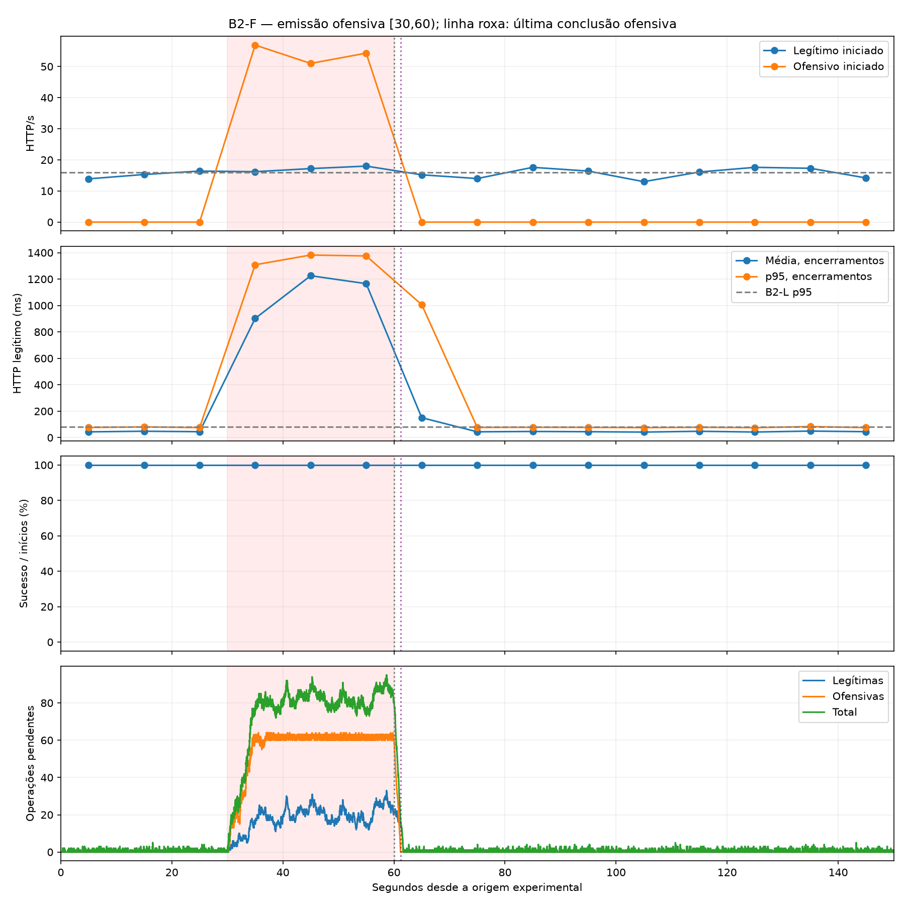
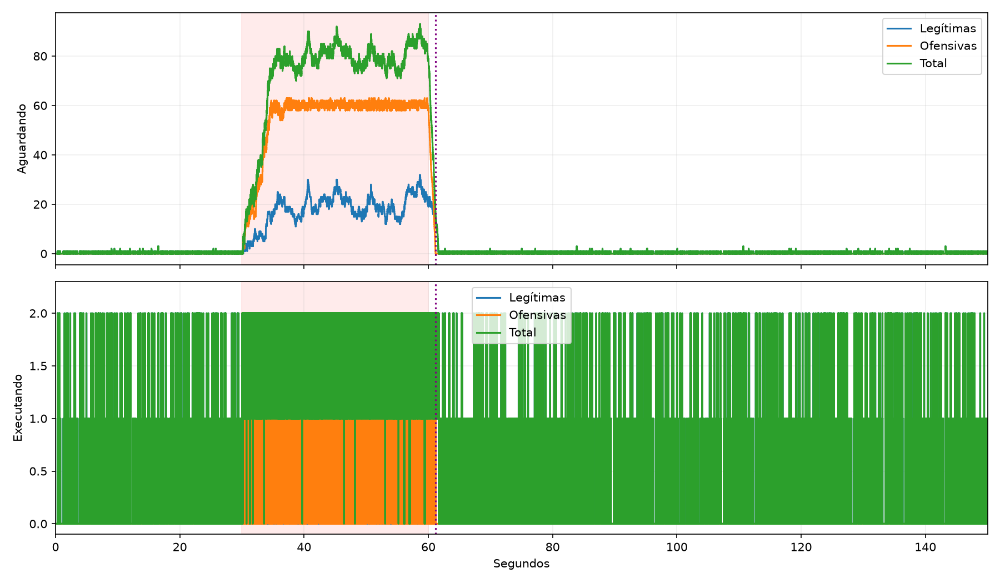

# B2-F — piloto combinado L2 + HTTP Request Flooding F2

**Caracterização exploratória concluída com uma única execução certificada. Os resultados separam emissão, atendimento HTTP, processamento computacional, residual e recuperação. A conclusão e a recomendação para encerrar B2 estão na seção 10. Não foram executadas novas intensidades ou campanhas adicionais.**

## 1. Identificação, configuração e comparabilidade

Run `e00439f74fb24daebb36d8905f88c37c`; dataset `/home/henrique-givisiez/Documents/Faculdade/TCC/TCC/experiment_results/b2-f-20261108T000313Z/dataset`; checkout `79bbe860f3843e9457868c917cac3c59c5ba0ac8`, branch refactor/project-organization e working tree inicialmente limpo. Uma única execução, returncode 0, completed/simulation_end; certificado `completed`, outcome `completed_integral`; cleanup_verified=true. Dataset válido/elegível e manifesto SHA256 `460817cee7aa7a89f45827b2df7793bcb3b54b8ef75887b4a2b182ee56dd9428` vinculado ao certificado final. Não houve repetição, build/pull, alteração do simulador ou interrupção por degradação.

configuration.json é a cópia rastreável do template pilot-combined-http_request_flooding.json, alterando somente ID e attack.rate=32, sem sobrescrever o original. L2: duas fontes × 8 RPS = 16 RPS, /medium durante 150 s. F2: http_request_flooding continuous, duas fontes × 32 RPS = 64 RPS, /medium em [30,60). Ambas as classes usam timeout 2 s; concorrência configurada 64 por classe, orçamento 32 por fonte. Uma vítima, dois workers, topologia direta sem NGINX, sem autoscaling/balanceamento, seed 20261107, captura TCP e diagnósticos ON. Os demais parâmetros do template foram preservados.

Imagens iguais a B2-L/B2-A, código/launcher aceitos pelo preflight protegido:

- Vítima: `sha256:03a186aa90eec03b874c82a887b245e7190fa45cd7256af3c077cb64943d52b0`.
- Quatro fontes: `sha256:b94212edd4d31c34998aea870caebc4ba145c1593d1b8dfdc27fe4917719fe3e`.

Comparabilidade verificada com B2-L e B2-A: normal_traffic, server, monitoring, diagnostics, topology, autoscaler, infrastructure, load_balancer, traffic_sources e IDs das imagens. Política exploratory-offensive-v1 preservada: RAM mínima 2 GiB, disco 4 GiB, limites observados de memória vítima 1 GiB/fonte 512 MiB, artefatos 512 MiB, frescor 5 s, timeout Docker 3 s e global 240 s. São proteções observacionais existentes, não quotas impostas de CPU/RAM. Antes da preparação: aproximadamente 11,9 GB de RAM disponível, 37,4 GB de disco e nenhum contêiner ativo. Docker Engine 29.9.3 e Python host 3.12.3; versões e recursos completos em initial_environment.json/image_inspect.json.

Fluxo existente: diagnostic_run com composição combined e --previous-run da B2-A → preflight e verificação de imagens → coleta única → encerramento/observação residual/limpeza → exportação → certificação → validação e análise offline. offensive_analysis v2 e os redutores/classificadores existentes foram reutilizados. Os scripts de B2-A foram adaptados somente nos artefatos deste run, corrigindo taxas e cenário; nenhuma alteração em detectores, calibração, geradores, vítima ou política.

## 2. Identidade das classes e emissão HTTP

Como ambos usam /medium, o endpoint não discrimina a classe. Inventário de fontes, request_id, tráfego declarado e eventos HTTP dos diagnósticos de cada fonte foram confrontados; classification_evidence.csv preserva a classificação de cada início. Operações computacionais usam a correlação existente por run_id/request_id/operation_id/event_id/traffic_class, com conflitos ou identidade insuficiente preservados.

P1=[0,30), P2=[30,60), P3=[60,150); coortes pelo início efetivo HTTP, incluindo os resultados de conclusões posteriores na coorte original. Total legítimo: [0,150)/150 s. Total ofensivo: inícios em [30,60)/30 s, sem diluir por 150 s.

| Classe | Coorte | RPS nominal / iniciado | Admissões | Submissões | Inícios | Expirações pré-HTTP |
|---|---|---|---|---|---|---|
| benign | Total | 16.00 / 15.893 | N/D | 2384 | 2384 | 0 |
| benign | P1 | 16.00 / 15.200 | N/D | 456 | 456 | 0 |
| benign | P2 | 16.00 / 17.133 | N/D | 514 | 514 | 0 |
| benign | P3 | 16.00 / 15.711 | N/D | 1414 | 1414 | 0 |
| attack | Total | 64.00 / 54.067 | 1813 | 1813 | 1622 | 191 |
| attack | P1 | 0.00 / 0.000 | 0 | 0 | 0 | 0 |
| attack | P2 | 64.00 / 54.067 | 1813 | 1813 | 1622 | 0 |
| attack | P3 | 0.00 / 0.000 | 0 | 0 | 0 | 191 |

Admissões legítimas não são medidas como evento independente (N/D, não zero). Submissões são contadas nos diagnósticos das fontes, em seus instantes reais; admissões/resoluções ofensivas vêm dos journals identificados. Expirações pré-HTTP não entram no denominador de disponibilidade da vítima. Planejamento nominal × duração é uma expectativa, não uma contagem de planos observados. O gerador ofensivo não emite planned separado; a primeira submissão legítima também pode não ter planned anterior. Todos os planos registrados e não submetidos foram preservados em emission_reconciliation.json.

As 191 expirações ocorreram em P3, ao processar tarefas admitidas/submetidas em P2 que não haviam iniciado HTTP antes do fechamento da janela. A tabela de expirações usa o instante real da decisão; todas pertencem a admissões de P2. Não houve 191 inícios ou novas admissões ofensivas em P3. A identidade dessas tarefas permanece em emission_reconciliation.json.

| Fonte | Classe | Planos registrados | Admissões | Submissões | Inícios HTTP | Expirações |
|---|---|---|---|---|---|---|
| normal_1 | benign | 1169 | N/D | 1169 | 1169 | 0 |
| normal_2 | benign | 1215 | N/D | 1215 | 1215 | 0 |
| attack_1 | attack | N/D | 895 | 895 | 802 | 93 |
| attack_2 | attack | N/D | 918 | 918 | 820 | 98 |

F2 entregou 1622 inícios em 30 s, 54.067 RPS contra 64 nominais; diferença -9.933 RPS (-15.52%). O valor 64×30=1.920 é expectativa nominal, não admissões observadas. Legítimos: 15.893 RPS no total e 17.133 RPS em P2. Emissão e resultados de atendimento são apresentados separadamente.

Reconciliação ofensiva: 1.813 admissões = 1.813 submissões = 1.622 inícios HTTP + 191 expirações pré-HTTP. Assim, a diferença de 298 frente à expectativa nominal de 1.920 se decompõe em 107 oportunidades nominais acima das admissões observadas e 191 tarefas admitidas que não iniciaram HTTP. Isso é uma decomposição contábil, sem atribuição causal do primeiro termo. O nominal não é um registro de planejamento medido.

## 3. Atendimento, disponibilidade e duração HTTP

| Classe | Coorte | Encerramentos | Respostas / 2xx | Erros HTTP | Timeouts | Erros conexão | Sem encerramento | Sucessos/inícios |
|---|---|---|---|---|---|---|---|---|
| benign | Total | 2384 | 2384 / 2384 | 0 | 0 | 0 | 0 | 2384/2384 (100.00%) |
| benign | P1 | 456 | 456 / 456 | 0 | 0 | 0 | 0 | 456/456 (100.00%) |
| benign | P2 | 514 | 514 / 514 | 0 | 0 | 0 | 0 | 514/514 (100.00%) |
| benign | P3 | 1414 | 1414 / 1414 | 0 | 0 | 0 | 0 | 1414/1414 (100.00%) |
| attack | Total | 1622 | 1622 / 1622 | 0 | 0 | 0 | 0 | 1622/1622 (100.00%) |
| attack | P1 | 0 | 0 / 0 | 0 | 0 | 0 | 0 | 0/0; N/D |
| attack | P2 | 1622 | 1622 / 1622 | 0 | 0 | 0 | 0 | 1622/1622 (100.00%) |
| attack | P3 | 0 | 0 / 0 | 0 | 0 | 0 | 0 | 0/0; N/D |

Disponibilidade legítima total = 2384/2384 = 100.0000%; P2 = 514/514 = 100.0000%. O denominador é o número de inícios HTTP legítimos, não admissões/planos, operações computacionais ou nominal×tempo. O RPS legítimo efetivamente iniciado é uma medida separada e não garante recebimento de respostas.

| Classe | Coorte | Encerramentos: média / mediana / p95 ms | Respostas: média / mediana / p95 ms |
|---|---|---|---|
| benign | Total | 279.92 / 40.76 / 1257.45 | 279.92 / 40.76 / 1257.45 |
| benign | P1 | 45.50 / 37.32 / 77.66 | 45.50 / 37.32 / 77.66 |
| benign | P2 | 1102.37 / 1177.93 / 1370.21 | 1102.37 / 1177.93 / 1370.21 |
| benign | P3 | 56.55 / 36.67 / 79.95 | 56.55 / 36.67 / 79.95 |
| attack | Total | 1102.98 / 1189.28 / 1375.15 | 1102.98 / 1189.28 / 1375.15 |
| attack | P1 | N/D / N/D / N/D | N/D / N/D / N/D |
| attack | P2 | 1102.98 / 1189.28 / 1375.15 | 1102.98 / 1189.28 / 1375.15 |
| attack | P3 | N/D / N/D / N/D | N/D / N/D / N/D |

As durações de encerramentos incluem timeouts. Durações somente das respostas são condicionais ao recebimento de HTTP e não representam tentativas sem resposta. Nenhuma duração foi imputada. Mediana convencional; p95 por posto mais próximo; mínimos/máximos e denominadores completos em http_by_period.csv/summary.json. Os instantes reais de conclusão permanecem em http_attempts.csv. Coortes que cruzam 30, 60 ou 150 s estão em summary.json/boundary_crossings.

Tentativas HTTP fora de [0,150): 0; detalhes integrais em summary.json/tail_http. Elas não são absorvidas por P3. Inícios ofensivos fora de [30,60) são verificados pelo analisador e journals; nenhum é presumido ausente apenas porque o gerador parou.

## 4. Processamento computacional e workers

| Classe | Coorte HTTP | Subm./inic./concl./falha | CPU/op ms | Parede/op ms | Espera média / mediana / p95 ms |
|---|---|---|---|---|---|
| benign | Total | 2384 / 2384 / 2384 / 0 | 28.74 | 28.72 | 237.23 / 1.39 / 1209.63 |
| benign | P1 | 456 / 456 / 456 / 0 | 29.02 | 29.00 | 2.25 / 1.21 / 9.62 |
| benign | P2 | 514 / 514 / 514 / 0 | 28.92 | 28.90 | 1060.51 / 1140.25 / 1329.36 |
| benign | P3 | 1414 / 1414 / 1414 / 0 | 28.59 | 28.57 | 13.74 / 1.28 / 17.44 |
| attack | Total | 1622 / 1622 / 1622 / 0 | 28.87 | 28.85 | 1034.29 / 1117.74 / 1301.43 |
| attack | P1 | 0 / 0 / 0 / 0 | N/D | N/D | N/D / N/D / N/D |
| attack | P2 | 1622 / 1622 / 1622 / 0 | 28.87 | 28.85 | 1034.29 / 1117.74 / 1301.43 |
| attack | P3 | 0 / 0 / 0 / 0 | N/D | N/D | N/D / N/D / N/D |

| Classe | Coorte | PID | Operações | Espera média / mediana / p95 ms |
|---|---|---|---|---|
| benign | Total | 26 | 1180 | 233.33 / 1.39 / 1213.98 |
| benign | Total | 27 | 1204 | 241.05 / 1.39 / 1205.76 |
| benign | P1 | 26 | 227 | 2.27 / 1.26 / 10.19 |
| benign | P1 | 27 | 229 | 2.23 / 1.18 / 9.33 |
| benign | P2 | 26 | 252 | 1056.07 / 1146.87 / 1328.37 |
| benign | P2 | 27 | 262 | 1064.77 / 1133.14 / 1329.36 |
| benign | P3 | 26 | 701 | 12.40 / 1.27 / 14.54 |
| benign | P3 | 27 | 713 | 15.07 / 1.28 / 18.47 |
| attack | Total | 26 | 805 | 1035.27 / 1118.47 / 1293.82 |
| attack | Total | 27 | 817 | 1033.33 / 1117.69 / 1308.66 |
| attack | P2 | 26 | 805 | 1035.27 / 1118.47 / 1293.82 |
| attack | P2 | 27 | 817 | 1033.33 / 1117.69 / 1308.66 |

No mesmo período P2 e endpoint /medium: CPU média legítima 28.921 ms/op; ofensiva 28.866 ms/op, razão ofensiva/legítima 0.998. A comparação é descritiva e não controla agendamento ou condições do host; diferenças não foram investigadas. Os dois tipos de operação são classificados pela identidade, não pelo custo ou endpoint. Operações de auditoria unknown ficam fora dessas métricas.

Espera entre work_submitted e work_started inclui fila, IPC e agendamento; não é uma medição pura da fila interna. Parede computacional e CPU/op usam os campos dos workers. Os PIDs só identificam processos desta execução. Timeouts HTTP não cancelam automaticamente trabalho já submetido à vítima; conclusão computacional e resposta recebida são eventos diferentes. computational_events_by_actual_time.json separa contagens por instante real de evento das coortes por início HTTP.

## 5. Filas, residual e marcos de recuperação

| Intervalo | Classe | Pico aguardando | Pico executando | Pico pendente |
|---|---|---|---|---|
| Total | benign | 32 | 2 | 33 |
| Total | attack | 63 | 2 | 64 |
| Total | total | 93 | 2 | 95 |
| P1 | benign | 3 | 2 | 5 |
| P1 | attack | 0 | 0 | 0 |
| P1 | total | 3 | 2 | 5 |
| P2 | benign | 32 | 2 | 33 |
| P2 | attack | 63 | 2 | 64 |
| P2 | total | 93 | 2 | 95 |
| P3 | benign | 23 | 2 | 23 |
| P3 | attack | 59 | 2 | 61 |
| P3 | total | 79 | 2 | 81 |

Máximos por classe podem ocorrer em instantes distintos: não se somam máximos independentes. Picos usam todas as transições observadas (queue_transitions.csv); instantes dos máximos em queue_peak_times.json. O analisador também preserva eventos por segundo e estados antes do término de cada bin; esses snapshots não substituem máximos intrassegundo.

| Instante− | Legítimas aguard./exec./pend. | Ofensivas aguard./exec./pend. | Total pendente |
|---|---|---|---|
| 30 s | 0 / 0 / 0 | 0 / 0 / 0 | 0 |
| 60 s | 20 / 0 / 20 | 59 / 2 / 61 | 81 |
| 70 s | 0 / 0 / 0 | 0 / 0 / 0 | 0 |
| 80 s | 0 / 1 / 1 | 0 / 0 / 0 | 1 |
| 90 s | 0 / 1 / 1 | 0 / 0 / 0 | 1 |
| 120 s | 0 / 0 / 0 | 0 / 0 / 0 | 0 |
| 150 s | 0 / 1 / 1 | 0 / 0 / 0 | 1 |

Em 60− s havia 61 operações ofensivas pendentes (59 aguardando, 2 executando), além de 20 legítimas. Snapshots imediatamente antes e após eventos exatamente em 60 s estão preservados. Submissões ofensivas a partir de 60 s: 0; conclusões ofensivas a partir desse instante: 61. Um início HTTP dentro da janela pode ter submissão computacional posterior; não se confundem os dois eventos.

Última conclusão computacional ofensiva: 61.199301 s (1.199301 s após o fim da emissão). Primeiro retorno da fila total a zero após 60 s: 61.663834 s. Último início legítimo com timeout: N/D s; último encerramento legítimo por timeout: N/D s. N/D indica ausência de timeout. São marcos distintos: encerramento de emissão, processamento ofensivo, atendimento legítimo e esvaziamento da fila total não são equivalentes. A drenagem descrita cobre operações identificadas e observadas, sem alegar impossibilidade universal de ingresso futuro.

## 6. Evolução temporal e recuperação

| Coorte legítima | Inícios/RPS | Sucessos/inícios | HTTP média / mediana / p95 ms | Espera média ms |
|---|---|---|---|---|
| 0-10 | 139 / 13.90 | 139/139 | 43.58 / 36.52 / 76.70 | 1.79 |
| 10-20 | 153 / 15.30 | 153/153 | 48.16 / 37.70 / 80.88 | 2.70 |
| 20-30 | 164 / 16.40 | 164/164 | 44.63 / 37.64 / 75.84 | 2.22 |
| 30-40 | 162 / 16.20 | 162/162 | 901.78 / 1128.05 / 1308.31 | 858.17 |
| 40-50 | 172 / 17.20 | 172/172 | 1225.33 / 1224.30 / 1382.11 | 1182.45 |
| 50-60 | 180 / 18.00 | 180/180 | 1165.41 / 1157.64 / 1375.07 | 1126.09 |
| 60-70 | 152 / 15.20 | 152/152 | 150.69 / 37.67 / 1006.57 | 106.44 |
| 70-80 | 140 / 14.00 | 140/140 | 43.84 / 35.44 / 77.06 | 1.81 |
| 80-90 | 176 / 17.60 | 176/176 | 46.36 / 37.68 / 78.07 | 3.04 |
| 90-100 | 164 / 16.40 | 164/164 | 44.58 / 36.72 / 77.24 | 3.00 |
| 100-110 | 130 / 13.00 | 130/130 | 41.78 / 35.11 / 75.39 | 1.75 |
| 110-120 | 161 / 16.10 | 161/161 | 47.83 / 38.93 / 77.93 | 3.66 |
| 120-130 | 176 / 17.60 | 176/176 | 42.24 / 35.13 / 75.29 | 1.92 |
| 130-140 | 173 / 17.30 | 173/173 | 49.28 / 39.89 / 83.33 | 2.58 |
| 140-150 | 142 / 14.20 | 142/142 | 44.72 / 35.85 / 75.84 | 2.64 |

Em [100,150), coorte descritiva comum à comparação com B2-A: 782/782 sucessos, 15.640 RPS, HTTP médio 45.32 ms, p95 78.32 ms, espera média 2.53 ms. Referência interna P1: 45.50/77.66 ms de média/p95 e 100.00% de disponibilidade. A evolução dos bins, e não apenas a média agregada de P3, sustenta a avaliação de recuperação.

A disponibilidade permaneceu 100% durante toda a execução: a recuperação observada é de duração/espera, não recuperação de respostas antes ausentes. [60,70) ainda mistura o residual e apresenta HTTP médio 150,69 ms e p95 1.006,57 ms. No primeiro bin completo de 10 s após o esvaziamento, [70,80), média 43,84 ms e p95 77,06 ms já se aproximam de P1 (45,50/77,66 ms). Sem critério científico pré-definido, não se declara um instante exato de recuperação; distinguem-se os marcos de computação/fila e a evidência das coortes HTTP.

## 7. Comportamento observado do gerador ofensivo

| Fonte | Classe | Pico submetidas−iniciadas | Despacho médio / mediano / p95 / máximo ms | Expirações pré-HTTP |
|---|---|---|---|---|
| normal_1 | benign | 2 | 0.43 / 0.38 / 0.89 / 2.86 | 0 |
| normal_2 | benign | 1 | 0.42 / 0.38 / 0.85 / 3.22 | 0 |
| attack_1 | attack | 98 | 1354.38 / 1293.97 / 2843.47 / 3099.48 | 93 |
| attack_2 | attack | 100 | 1546.75 / 1748.38 / 3338.01 / 3758.80 | 98 |

O pico submetidas−iniciadas é a diferença observada entre submissões e inícios de tarefas, não acesso à fila interna do executor; um slot em trânsito pode produzir pico 1 sem acúmulo relevante. O despacho inclui tarefas que depois possam expirar. Expirações pré-HTTP são descartes no cliente e não falhas de atendimento da vítima. As métricas acima registram apenas o comportamento desta execução. A concorrência permaneceu 64; duração HTTP e capacidade computacional participam do comportamento observado, sem atribuir causalmente toda diferença de vazão a um único gargalo. A investigação anterior sobre limite de Flooding não foi reaberta.

## 8. Comparação descritiva B2-L × B2-A × B2-F

| Execução/coorte | RPS legítimo | Disponibilidade | HTTP média / p95 ms |
|---|---|---|---|
| B2-L total | 15.9 | 100% | 46,87 / 79,71 |
| B2-A P1 | 15.20 | 100.00% | 53.27 / 90.08 |
| B2-A P2 | 17.13 | 8.37% | 1939.93 / 2006.48 |
| B2-A P3 | 15.72 | 66.36% | 746.78 / 2006.02 |
| B2-A Total | 15.90 | 60.29% | 871.32 / 2006.04 |
| B2-F P1 | 15.20 | 100.00% | 45.50 / 77.66 |
| B2-F P2 | 17.13 | 100.00% | 1102.37 / 1370.21 |
| B2-F P3 | 15.71 | 100.00% | 56.55 / 79.95 |
| B2-F Total | 15.89 | 100.00% | 279.92 / 1257.45 |

| Execução | RPS ofensivo realizado | Pico total pendente | Ofensivas pendentes em 60− | Última conclusão ofensiva s | Primeiro total zero pós-60 s |
|---|---|---|---|---|---|
| B2-A | 7.933 | 361 | 103 | 83.482269 | 93.567526 |
| B2-F | 54.067 | 95 | 61 | 61.199301 | 61.663834 |

Em P2 da B2-F, a disponibilidade legítima foi 100.00%, variação de 0.00 pontos percentuais frente à B2-L/P1 (ambas 100% nesta referência). O HTTP médio em P2 foi 23.52× B2-L e 24.23× P1 interno. B2-A teve P2 com 8,37%, HTTP médio 1.939,93 ms e residual ofensivo de 23,48 s; suas métricas completas são mantidas lado a lado. P1 da B2-F e CPU/op também são referências internas: igualdade de imagens não implica desempenho determinístico do host.

A3 e F2 não são cargas computacionais equivalentes: diferem em mecanismo, intensidade e custo por operação. As comparações são descritivas, com uma realização por configuração e mesma semente preservada; não demonstram causalidade definitiva nem estabilidade populacional. Nenhum teste inferencial ou intervalo de confiança foi produzido.

## 9. Integridade, recursos e limitações

O outcome operacional completed_integral indica que o procedimento terminou sem falha dos gates e sem erros HTTP/transportes detectados pelo certificado; não certifica ausência de degradação de latência ou de filas. A duração e a espera elevadas observadas em P2 permanecem resultados de degradação mesmo com disponibilidade 100%.

| Período | Ticks CPU | CPU média / máxima % Docker | Memória média / máxima MiB | Gap mediano / máximo s | Amostras brutas |
|---|---|---|---|---|---|
| Total | 20 | 77.29 / 230.04 | 43.01 / 48.49 | 6.048 / 10.231 | 50 |
| P1 | 2 | 52.07 / 53.97 | 27.75 / 28.11 | 10.058 / 10.058 | 10 |
| P2 | 3 | 167.53 / 230.04 | 37.11 / 42.81 | 10.179 / 10.231 | 10 |
| P3 | 15 | 62.61 / 228.93 | 46.23 / 48.49 | 6.038 / 6.084 | 30 |

Ticks em [0,150): 20, primeiro em 10.156 s, último em 145.175 s; há lacunas antes/depois dessas observações e entre amostras. Monitoring configurado: intervalo 5 s, stats_poll 1 s, histórico 30 s; a cadência efetiva acima é distinta. Aquisições brutas, gaps, contagens por fase e registros fora da janela estão no dataset/existing_analyzer/summary.json. Nenhuma interpolação ou alteração de telemetria. As médias são de amostras observadas, não integração temporal; Docker 100% equivale aproximadamente a um núcleo lógico. A CPU esparsa é pendência anterior à campanha definitiva, sem investigação nesta etapa.

Capturas PCAP/CSV aceitas: 23176 e 23176 pacotes, respectivamente; descartes pelo kernel 0/0. Vítima: 20131 eventos, sequência íntegra, fechamento completo, perdas 0 e erros de escrita 0. Quatro diagnósticos/journals completos, identidades reconciliadas, 4006 inícios correlacionados com operações; conflitos de identidade 0, ciclos parciais 0. Relógios comparáveis certificados pelo fluxo existente.

Todos os 103 arquivos do manifesto foram conferidos por tamanho/SHA256; arquivos brutos exportados comparados sem divergências, sem alteração dos dados. O snapshot exportado anterior ao certificado não foi reescrito. Existem 20 operações unknown de auditoria, com handlers phase=capture_audit e endpoint /, anteriores à origem nominal. Elas permanecem separadas, sem forçar identidade legítima/ofensiva. offensive_analysis v2 foi usado por ser compatível com combined; suas insuficiências de identidade e limitações são preservadas em existing_analyzer/, sem forçar elegibilidade. O analisador legítimo A1 não foi aplicado a uma composição incompatível.

Estados finais observados e encerramento constam em queue_residual.json, certificado e final_environment.json. Limpeza confirmada, redes preexistentes vazias, quatro contêineres externos preservados. Não houve limpeza ampla de Docker. A observação sustenta os resultados HTTP e de fila; não elimina efeitos de condições do host, resolução esparsa de CPU ou a necessidade de protocolo/repetições antes de conclusões científicas.

## 10. Conclusão e encerramento da B2

**F2 comprometeu o atendimento legítimo principalmente pela duração e espera observadas:** P2 teve 100.00% de disponibilidade (514/514), HTTP médio 1102.37 ms e p95 1370.21 ms, contra 45.50/77.66 ms em P1. O RPS ofensivo efetivo foi 54.067, frente a 64 nominais, com 191 expirações pré-HTTP. Resultados de despacho e acúmulo no gerador foram explicitados; não se atribuem essas expirações à vítima.

Houve formação de filas, com pico total de 95 operações pendentes. O processamento ofensivo persistiu até 61.199 s; fila total voltou a zero em 61.664 s. Os bins de P3 e a coorte final [100,150), com 782/782 sucessos e HTTP médio 45.32 ms, documentam a recuperação observada. Encerramento de emissão não foi tratado como encerramento dos efeitos.

**F2 é uma candidata exploratória adequada para representar Flooding no protocolo, desde que especificada por configuração nominal e carga efetivamente entregue, sem tratá-la como carga equivalente a A3 ou como escolha definitiva validada.** Sua adequação não exige necessariamente perda de disponibilidade: atraso e fila também caracterizam degradação. O efeito observado e a recuperabilidade devem orientar os critérios científicos, não apenas a taxa de erros ou o nominal.

**Recomenda-se encerrar a caracterização exploratória B2 e avançar à consolidação do protocolo científico.** Consolidar as configurações e IDs imutáveis, definição de disponibilidade/duração e coortes, critérios e janelas de recuperação, carga efetiva/expirações e tratamento de unknown; resolver/documentar observabilidade CPU e definir delineamento/repetições antes da campanha definitiva. Isso é recomendação metodológica, não início da campanha. Não foram executadas novas intensidades, B2-L/B2-A novamente, calibração ou detectores.

## 11. Artefatos e rastreabilidade

Dataset/raw, configuração, preflight/attempt, proveniência de código/imagens, captura, HTTP, CPU, diagnósticos e certificado: experiment_results/b2-f-20261108T000313Z/. Aqui: configuração/compatibilidade, comandos/logs/ambientes, existing_analyzer/, summary.json, validação e hashes, evidência de classificação, emissão/planejamento/despacho por fonte, tentativas/operações completas, tabelas por período e 10 s, workers, transições/picos/estados residuais, recovery.json, comparação B2-L/B2-A/B2-F, recursos, reconciliação de auditoria, limpeza e figuras PNG/SVG. Scripts locais reutilizados documentam a análise. analysis_manifest.json vincula os artefatos e o dataset por SHA256. Commit local solicitado; sem push.
