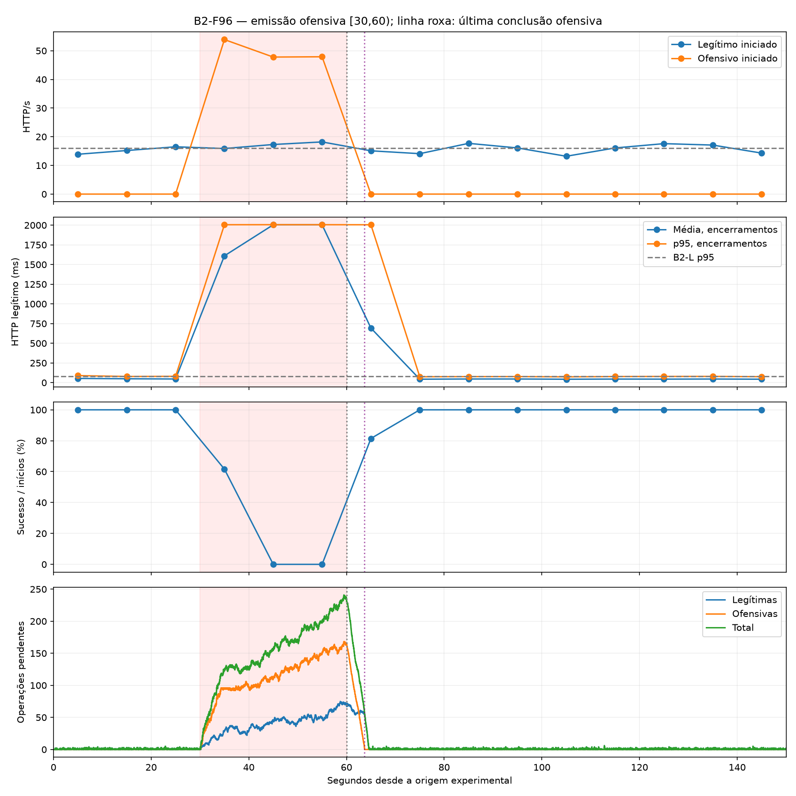

# B2-F96 — comparação exploratória de concorrência ofensiva 64 × 96

## Configuração e certificação

Uma única execução: run `9aeffeec6d384eb393dd8242d7c26bc4`, checkout `7324eb97601ef5e7fbc467014f049786167a2ce3`, branch refactor/project-organization, working tree inicialmente limpo. Dataset `/home/henrique-givisiez/Documents/Faculdade/TCC/TCC/experiment_results/b2-f96-20261108T002312Z/dataset`. Returncode 0; certificado `completed`, outcome `completed_with_http_degradation`; dataset válido/elegível, limpeza verificada. Manifesto SHA256 `07f25ea0a173ec4a9ade3c3284ee7ea14944b694d2b90cc3da72e89d8770a25f`. Não houve repetição, build/pull ou alteração de código/instrumentação.

A configuração partiu de experiment_results/b2-f-20261108T000313Z/raw/effective_config.json, não do template. Comparação integral confirmou somente novo ID e attack.max_concurrent_sends 64→96 (32→48 por fonte). Foram preservados attack.rate=32, duas fontes ofensivas, 64 RPS agregados /medium em [30,60); L2=2×8 RPS /medium em [0,150); timeout 2 s; pool vítima dois workers; topologia direta; sem autoscaling/NGINX/balanceamento; seed, kernel, instrumentação e política exploratory-offensive-v1. configuration.json e execution_procedure.py preservam a cópia e a comparação.

Imagens imutáveis iguais à B2-F e aceitas pelo preflight: vítima `sha256:03a186aa90eec03b874c82a887b245e7190fa45cd7256af3c077cb64943d52b0`; fontes `sha256:b94212edd4d31c34998aea870caebc4ba145c1593d1b8dfdc27fe4917719fe3e`. Docker Engine 29.9.3, Python host 3.12.3. Auditoria: cerca de 10,4 GB RAM disponível, 37,3 GB de disco, nenhum contêiner ativo. Limites operacionais preservados: host RAM mínima 2 GiB, disco 4 GiB, memória observada vítima 1 GiB/fonte 512 MiB, artefatos 512 MiB, frescor 5 s, timeout Docker 3 s e global 240 s. São salvaguardas existentes, não quotas novas. Detalhes completos em initial_environment.json e no certificado.

## Comparação direta

| Indicador | B2-F / orçamento 64 | B2-F96 / orçamento 96 |
|---|---|---|
| RPS ofensivo nominal | 64.000 | 64.000 |
| Posições ofensivas agregadas | 64.000 | 96.000 |
| Posições por fonte | 32.000 | 48.000 |
| RPS ofensivo iniciado | 54.067 | 49.867 |
| Inícios HTTP ofensivos | 1622.000 | 1496.000 |
| Admissões ofensivas | 1813.000 | 1804.000 |
| Submissões ofensivas | 1813.000 | 1804.000 |
| Expirações pré-HTTP | 191.000 | 308.000 |
| Respostas ofensivas | 1622.000 | 351.000 |
| Timeouts ofensivos | 0.000 | 1145.000 |
| Disponibilidade legítima P2 % | 100.000 | 19.066 |
| Sucessos legítimos P2 | 514.000 | 98.000 |
| Inícios legítimos P2 | 514.000 | 514.000 |
| Timeouts legítimos P2 | 0.000 | 416.000 |
| RPS legítimo iniciado P2 | 17.133 | 17.133 |
| HTTP legítimo P2 médio ms | 1102.370 | 1882.847 |
| HTTP legítimo P2 p95 ms | 1370.211 | 2005.962 |
| Espera legítima P2 média ms | 1060.506 | 2521.781 |
| Pico agregado de operações pendentes | 95.000 | 241.000 |
| Ofensivas pendentes em 60− | 61.000 | 166.000 |
| Última conclusão ofensiva s | 61.199 | 63.699 |
| Residual ofensivo após 60 s | 1.199 | 3.699 |
| Primeiro total zero após 60 s | 61.664 | 64.654 |

A mudança observada na taxa ofensiva iniciada foi -4.200 RPS (-7.77%), ou -126 inícios dentro de [30,60). Expirações pré-HTTP: 191→308. Não se usa nominal×30 como contagem de planos registrados. Admissões = submissões = inícios HTTP + expirações foi verificado por fonte. Expiração ocorre antes do HTTP e não é falha de atendimento da vítima.

## Emissão, despacho e concorrência utilizada

| Execução | Fonte ofensiva | Admissões/submissões | Inícios | Expirações | Pico tarefas não iniciadas | Despacho médio / p95 / máximo ms |
|---|---|---|---|---|---|---|
| 64 | attack_1 | 895/895 | 802 | 93 | 98 | 1354.38 / 2843.47 / 3099.48 |
| 64 | attack_2 | 918/918 | 820 | 98 | 100 | 1546.75 / 3338.01 / 3758.80 |
| 96 | attack_1 | 892/892 | 739 | 153 | 153 | 2024.12 / 4810.08 / 5215.71 |
| 96 | attack_2 | 912/912 | 757 | 155 | 157 | 2363.01 / 5377.84 / 5947.10 |

Despacho médio ofensivo agregado ponderado pelas tarefas: 1451.79→2195.44 ms. A diferença submetidas−iniciadas é observada, não acesso à fila interna do executor; despacho inclui tarefas posteriormente expiradas. Os planos registrados e as tarefas sem HTTP estão preservados em emission_reconciliation.json. Admissão legítima não é medida independentemente (N/D).

| Execução | Fonte ofensiva | Posições configuradas | Pico tarefas executando | Pico HTTP em voo | Ocupação HTTP média P2 |
|---|---|---|---|---|---|
| B2-F | attack_1 | 32 | 32 | 32 | 28.93 |
| B2-F | attack_2 | 32 | 32 | 32 | 29.38 |
| B2-F96 | attack_1 | 48 | 48 | 48 | 44.45 |
| B2-F96 | attack_2 | 48 | 48 | 48 | 44.94 |

A concorrência efetiva foi reconstruída offline pelos pares task_started/task_finished e http_started/http_finished dos diagnósticos existentes, em [30,60). Ocupação média usa os tempos reais dos eventos, integrados nessa janela; ela não interpola CPU. Pico de cada fonte pode ocorrer em instantes distintos, portanto não se somam picos como se fossem um pico agregado medido. Tarefa executando inclui trabalho local antes/depois do HTTP. Aumentar o orçamento não comprova ausência de outras limitações de emissão ou da vítima.

## Atendimento legítimo e processamento computacional

| Execução/coorte | RPS legítimo | Sucessos/inícios | Timeouts | HTTP média / mediana / p95 ms | Espera média ms | CPU/op média ms |
|---|---|---|---|---|---|---|
| 64 P1 | 15.200 | 456/456 | 0 | 45.50 / 37.32 / 77.66 | 2.25 | 29.02 |
| 64 P2 | 17.133 | 514/514 | 0 | 1102.37 / 1177.93 / 1370.21 | 1060.51 | 28.92 |
| 64 P3 | 15.711 | 1414/1414 | 0 | 56.55 / 36.67 / 79.95 | 13.74 | 28.59 |
| 96 P1 | 15.200 | 456/456 | 0 | 49.45 / 40.56 / 82.79 | 2.66 | 32.04 |
| 96 P2 | 17.133 | 98/514 | 416 | 1882.85 / 2004.55 / 2005.96 | 2521.78 | 32.92 |
| 96 P3 | 15.700 | 1385/1413 | 28 | 114.19 / 37.51 / 93.23 | 90.71 | 28.11 |

Disponibilidade é sucessos/inícios HTTP, separada do RPS iniciado. Coortes P1=[0,30), P2=[30,60), P3=[60,150) pelo início HTTP, preservando conclusões reais posteriores e tentativas após 150 s como tail. Encerramentos incluem timeouts; distribuições somente de respostas e denominadores estão em http_by_period.csv/summary.json, sem imputação. Ambas as classes usam /medium e são classificadas pelas identidades das fontes e correlação de IDs, não pelo endpoint.

Dois inícios legítimos tardios, em 150,002832396 s e 150,008035999 s, receberam HTTP 200 e permanecem na coorte tail, fora dos totais [0,150). Por isso as fontes registram 2.385 submissões/inícios legítimos completos, enquanto a janela nominal contém 2.383. Os IDs e tempos reais de conclusão estão preservados em summary.json/tail_http e http_attempts.csv.

| Execução/classe | Subm./inic./concl./falha | CPU/op ms | Parede/op ms | Espera média / mediana / p95 ms |
|---|---|---|---|---|
| 64 benign | 2384 / 2384 / 2384 / 0 | 28.74 | 28.72 | 237.23 / 1.39 / 1209.63 |
| 64 attack | 1622 / 1622 / 1622 / 0 | 28.87 | 28.85 | 1034.29 / 1117.74 / 1301.43 |
| 96 benign | 2383 / 2383 / 2383 / 0 | 29.90 | 29.94 | 598.23 / 1.45 / 3264.29 |
| 96 attack | 1496 / 1496 / 1496 / 0 | 33.08 | 33.09 | 2433.36 / 2483.51 / 3609.69 |

Espera computacional inclui fila, IPC e agendamento. Operações concluídas após timeout continuam sendo trabalho executado e não uma resposta HTTP recebida. Distribuição entre workers e seus tempos está em workers_by_period.csv. Comparar CPU/op de P1 ajuda a contextualizar diferenças entre execuções; mesmas imagens não tornam o custo computacional ou o host determinísticos. Não foi aberta investigação adicional.

## Filas, residual e recuperação

B2-F96: em 60− s havia 166 operações ofensivas e 68 legítimas pendentes. Última conclusão ofensiva em 63.699371 s, 3.699371 s após emissão; primeiro total pendente zero após 60 s em 64.654068 s. Último início/encerramento legítimo com timeout: 62.049082 / 64.053618 s (N/D=nenhum). Snapshots antes/depois de 60 s e conclusões reais estão em queue_residual.json; todas as transições e picos foram preservados.

Fim da emissão, fim do processamento ofensivo, recuperação do atendimento e fila total vazia são marcos distintos. As filas são observadas por eventos completos, sem inferi-las só da CPU. A recuperação é avaliada pelos bins HTTP e pela redução da espera, sem impor como requisito que apareçam timeouts. Não se afirma um instante exato de recuperação sem critério científico previamente definido.

| Coorte B2-F96 | RPS legítimo | Sucessos/inícios | HTTP média / p95 ms | Espera média ms |
|---|---|---|---|---|
| 0-10 | 13.900 | 139/139 | 53.64 / 89.69 | 2.41 |
| 10-20 | 15.200 | 152/152 | 49.07 / 78.18 | 2.18 |
| 20-30 | 16.500 | 165/165 | 46.27 / 80.18 | 3.32 |
| 30-40 | 15.900 | 98/159 | 1610.59 / 2005.72 | 1589.49 |
| 40-50 | 17.300 | 0/173 | 2004.80 / 2006.10 | 2516.21 |
| 50-60 | 18.200 | 0/182 | 2004.78 / 2005.94 | 3341.55 |
| 60-70 | 15.100 | 123/151 | 692.63 / 2005.30 | 829.58 |
| 70-80 | 14.100 | 141/141 | 43.70 / 74.80 | 1.91 |
| 80-90 | 17.700 | 177/177 | 46.25 / 76.84 | 2.12 |
| 90-100 | 16.100 | 161/161 | 46.26 / 77.19 | 2.49 |
| 100-110 | 13.200 | 132/132 | 43.42 / 73.64 | 2.59 |
| 110-120 | 16.100 | 161/161 | 45.36 / 77.64 | 3.46 |
| 120-130 | 17.600 | 176/176 | 44.55 / 78.73 | 1.94 |
| 130-140 | 17.100 | 171/171 | 45.86 / 79.26 | 1.68 |
| 140-150 | 14.300 | 143/143 | 43.69 / 75.61 | 2.32 |

Na coorte final [100,150), 783/783 respostas bem-sucedidas, HTTP médio 44.65 ms, p95 77.77 ms, espera média 2.37 ms. B2-F original nessa mesma coorte: 782/782, 45,32 ms de média, 78,32 ms de p95. São comparações descritivas, não demonstração de estabilidade populacional.

## Integridade e limitações

Dataset válido/elegível e hashes verificados; certificado vinculado ao manifesto; raw/export comparados sem divergências. Capturas aceitas PCAP/CSV: 27327/27327 pacotes, descartes pelo kernel 0/0. Vítima: 19506 eventos íntegros, perdas/erros 0/0. Quatro fontes com sequência, journals, fechamento e identidades reconciliados; 3881 inícios correlacionados a operações, conflitos 0, ciclos parciais 0. Operações unknown de auditoria: 20, separadas e não convertidas artificialmente em legítimas/ofensivas. Inícios HTTP fora de [0,150): 2; detalhes em summary.json. Nenhum início ofensivo fora da janela, verificado pelo analisador.

| Período | Ticks CPU | CPU média/máx % Docker | Memória máx MiB | Gap mediano/máx s |
|---|---|---|---|---|
| Total | 20 | 88.53/242.88 | 56.66 | 6.053/10.179 |
| P1 | 2 | 60.53/64.19 | 27.89 | 10.059/10.059 |
| P2 | 3 | 172.51/238.59 | 48.94 | 10.163/10.179 |
| P3 | 15 | 75.46/242.88 | 56.66 | 6.018/6.206 |

CPU permanece esparsa: médias de amostras, sem interpolação ou alteração de cadência, não médias contínuas. Gaps e cobertura em resources_by_period.csv/existing_analyzer/summary.json. Duas realizações sequenciais com mesma semente não isolam causalmente a mudança de orçamento; custo por operação e condições do host podem variar. Nenhum teste inferencial, intervalo de confiança ou alegação de gargalo único. O certificado operacional não substitui os critérios de latência/recuperação do protocolo. Limpeza verificada: nenhum contêiner experimental remanescente, redes preexistentes vazias e quatro contêineres externos preservados, sem limpeza ampla.

## Conclusão e decisão

**Recomendação A — manter F2 com orçamento 64 no protocolo.** Nesta comparação, 96 não cumpriu o objetivo de entregar mais inícios e reduzir descartes: 54,067→49,867 RPS (−7,77%; −126 inícios) e 191→308 expirações (+117; +61,26%). A ocupação extra foi real (pico 48/48 por fonte, médias HTTP 44,45/44,94), mas traduziu-se em mais trabalho em voo e espera, não em maior vazão.

A degradação adicional foi relevante: disponibilidade legítima P2 de 100%→19,07% (98/514; 416 timeouts), HTTP médio 1.102,37→1.882,85 ms, espera computacional média 1.060,51→2.521,78 ms; pico total pendente 95→241 e ofensivas pendentes em 60− de 61→166. O residual ofensivo aumentou de 1,199 para 3,699 s. Maior dano não é, isoladamente, o benefício de emissão que motivou o teste; timeouts não eram requisito de sucesso.

O cenário foi operacionalmente aceitável e íntegro, mas não há benefício observado que justifique alterar o protocolo para 96. Isso não demonstra que aumentar concorrência sempre reduz vazão: P1 já tinha CPU/op média de 32,04 ms contra 29,02 ms, e em P2 a CPU/op ofensiva foi 33,08 contra 28,87 ms na B2-F original. As condições não foram isoladas causalmente. A decisão conserva a configuração já caracterizada diante de uma realização adicional sem melhora de entrega, evitando custo de revisão do protocolo sem suporte empírico favorável.

Depois desta única execução adicional, recomenda-se encerrar B2 e consolidar o protocolo científico, registrando orçamento escolhido, carga nominal/efetiva, expirações, critérios de recuperação, custo por operação e pendência da observabilidade CPU. Não executar outros orçamentos, F3, novas investigações ou a campanha definitiva nesta atividade.

Configuração efetiva, preflight/attempt, código/imagens, HTTP, diagnósticos, captura, CPU, dataset e certificado: experiment_results/b2-f96-20261108T002312Z/. Aqui estão logs, scripts reutilizados, comparação tabular JSON, medições de concorrência/despacho, tabelas HTTP/computacionais/filas, correlação por identidade, reconciliações, figuras e manifestos. analysis_manifest.json vincula o relatório ao dataset e aos artefatos por SHA256. Commit local solicitado, sem push.
