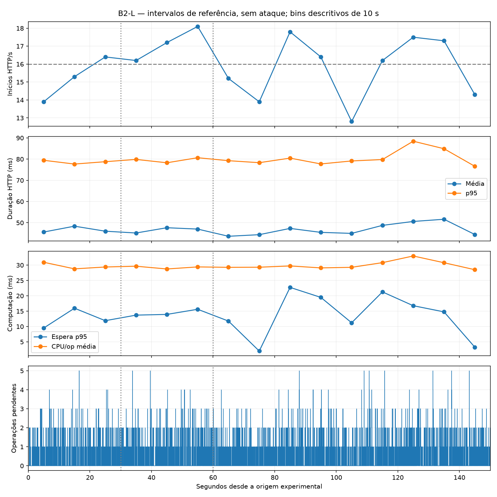

# B2-L — validação exploratória legítima L2

**Conclusão: sim. L2 apresentou comportamento suficientemente estável nesta execução exploratória e na infraestrutura atual para servir como referência de B2-A e B2-F. Recomenda-se avançar ao planejamento/execução autorizada de B2-A, preservando as ressalvas de fronteira temporal e observabilidade descritas abaixo. B2-A e B2-F não foram executadas.**

## 1. Ambiente e configuração

Run `c5e06e3441e4499c94fc62275c5d9ff4`; início UTC 2026-11-07 23:26:07 (20:26:07 em São Paulo). Branch `refactor/project-organization`; SHA `fa3936e1d9dcce6c941cf79701c3fc58dba4d9fd`; working tree limpo na auditoria inicial. Apenas artefatos novos foram acrescentados em reports. Docker Engine 29.9.3; Python host 3.12.3; detalhes de Engine, SO, pacotes, CPU e memória em initial_environment.json e image_inspect.json.

Template `experiments/configs/protected_compositions/pilot-legitimate.json`, copiado sem alteração para config.json: legitimate; topologia direta; duas fontes × 8 RPS; nominal agregado 16 RPS; /medium; nenhuma fonte ofensiva; dois workers; 150 s; timeout 2 s; captura TCP e diagnósticos habilitados. Concorrência configurada 64 agregada, orçamento 32 por fonte. Seed 20261107, autoscaling e balanceador desabilitados; fila diagnóstica 4096. Monitoring: intervalo 5 s, stats_poll 1 s, histórico 30 s; cadência efetiva distinta, documentada adiante. Configuração efetiva completa no dataset.

Imagens reutilizadas, sem build/pull, verificadas contra arquivos e launcher do checkout pelo executor:

- Vítima: `sha256:03a186aa90eec03b874c82a887b245e7190fa45cd7256af3c077cb64943d52b0`.
- Ambas as fontes: `sha256:b94212edd4d31c34998aea870caebc4ba145c1593d1b8dfdc27fe4917719fe3e`.

Política exploratory-offensive-v1 inalterada: RAM host mínima 2 GiB; disco mínimo 4 GiB; memória observada máxima por vítima 1 GiB e por fonte 512 MiB; artefatos 512 MiB; frescor 5 s; timeout Docker 3 s; orçamento global 240 s. São salvaguardas observacionais, não quotas de recursos impostas. Auditoria inicial: RAM disponível 12.019.781.632 bytes e disco 37.532.319.744 bytes no preflight. Recursos e versões completos foram preservados para comparação contemporânea.

## 2. Procedimento e integridade

Foi realizada uma única execução pelo diagnostic_run existente: verificação de composição/política → preflight protegido → verificação de código das imagens → run_recorded → encerramento/drenagem/limpeza → exportação → certificação e validação. Returncode 0; completed/simulation_end; certificado completed, outcome completed_integral; procedure_completed e cleanup_verified verdadeiros. Dataset válido e elegível. Certificado final vinculado ao run e ao SHA256 do manifesto; o snapshot operacional exportado anterior ao certificado não foi reescrito.

Todos os 77 arquivos do manifesto foram conferidos por tamanho/SHA256. 74 arquivos brutos exportados também foram comparados ao manifesto; sem divergência. PCAP e CSV aceitos: 12.594 pacotes capturados por cada processo, zero descartados pelo kernel. Eventos da vítima: 11.981, sequência íntegra, zero perdas/erros de escrita, observação fechada e completa. Fontes: 7.015 e 7.303 eventos, sequências completas e zero perdas. Não houve conflitos de identidade ou ciclos computacionais parciais. Relógios da vítima e das fontes certificados como comparáveis pelo procedimento existente.

O analisador legítimo existente foi executado e seu resultado preservado em existing_analyzer/. Ele marcou a execução como não elegível para sua comparação principal por 31 eventos sem request_id. A reconciliação por operation_id identifica dez operações completas com handlers explicitamente marcados capture_audit, endpoint /, mais o fechamento da observação: 30 eventos de trabalho + 1 fechamento. Essas dez operações permanecem unknown e excluídas das métricas legítimas; não foram convertidas artificialmente em tráfego legítimo. audit_reconciliation.json preserva cada ID e intervalo. A exclusão do analisador legado permanece visível; a análise descritiva B2-L usa a classificação e o redutor computacional existentes, com essa reconciliação explícita. Isso não altera o certificado ou os dados.

A última falha offline foi uma asserção que incluía IDs apenas planejados na reconciliação de tarefas submetidas. A correção limita essa checagem a IDs com submissão e preserva dois planos sem submissão (um por fonte). Os 2.386 ciclos submetidos têm, cada um, submissão, início de tarefa, início/fim HTTP e fim de tarefa. Planos não submetidos não são expirações ou falhas da vítima. A interrupção acidental foi retomada somente offline; nenhuma repetição experimental. Histórico em offline_analysis_history.json; log final em analysis_final.log.

## 3. Emissão, atendimento e disponibilidade

P1=[0,30), P2=[30,60), P3=[60,150) são intervalos de referência, sem fases reais de ataque. As coortes são definidas pelo início HTTP; conclusões posteriores permanecem na coorte original. Total abaixo é a janela nominal [0,150).

| Coorte | Nominal RPS | RPS iniciado | Δ RPS | Submissões cliente | Inícios | HTTP 2xx / inícios | Disponibilidade |
|---|---|---|---|---|---|---|---|
| Total | 16 | 15.900 | -0.100 | 2385 | 2385 | 2385 / 2385 | 100% |
| P1 | 16 | 15.200 | -0.800 | 456 | 456 | 456 / 456 | 100% |
| P2 | 16 | 17.167 | 1.167 | 515 | 515 | 515 / 515 | 100% |
| P3 | 16 | 15.711 | -0.289 | 1414 | 1414 | 1414 / 1414 | 100% |

A janela entregou 2.385 tentativas versus 2.400 esperadas por nominal × duração: diferença −15 (−0,625%). Por período: −5,00%, +7,29% e −1,81% do nominal. A taxa oscila entre períodos, sem queda progressiva; não se exige igualdade exata com o nominal. Admissões não têm evento independente neste gerador e são N/D; submissões são medidas diretamente nos diagnósticos das fontes. Não se deve apresentar ausência de evento de admissão como zero admissões. Expirações anteriores ao HTTP: zero, sustentado pela reconciliação integral das tarefas submetidas.

Em cada linha, encerramentos conhecidos = respostas recebidas = respostas HTTP 200 = inícios. Erros HTTP, timeouts, erros de conexão e tentativas sem encerramento observado: zero em todos os períodos. A disponibilidade é explicitamente 2.385/2.385=100% na janela nominal; não usa planos ou descartes pré-HTTP como denominador.

**Fronteira final:** há 2.386 tentativas no registro completo, todas HTTP 200, disponibilidade observada 2.386/2.386=100%. Uma começou em 150,002278277 s e terminou em 150,078272235 s (75,993958 ms): request_normal_2_000001217. Está na coorte tail, fora de P3 e do cálculo 2.385/150=15,90 RPS. O total bruto não foi truncado ou ocultado. Outra tentativa iniciou em 149,965043583 s e concluiu em 150,000263984 s: continua em P3. A observação demonstra pequeno início após a fronteira; não se afirma garantia estrita de cessação em 150 s.

A tentativa request_normal_1_000000489 começou em P2 e concluiu em P3. Ela permanece entre as 515 tentativas de P2 e seus resultados/duração integram essa coorte. A submissão/início/conclusão computacional dessa tentativa ocorreu em P3: contagens por instante real de evento computacional são 456/514/1.415, enquanto coortes por início HTTP são 456/515/1.414. Ambos os eixos estão preservados, sem deslocar a coorte HTTP.

## 4. Duração HTTP

| Coorte | Média ms | Mediana ms | p95 ms | Mínimo ms | Máximo ms |
|---|---|---|---|---|---|
| Total | 46.87 | 38.32 | 79.71 | 24.10 | 130.86 |
| P1 | 46.69 | 38.85 | 78.67 | 25.83 | 118.85 |
| P2 | 46.64 | 37.67 | 78.74 | 25.35 | 103.23 |
| P3 | 47.02 | 38.42 | 80.72 | 24.10 | 130.86 |

Neste run todas as tentativas encerradas receberam resposta; portanto distribuições de duração de encerramentos conhecidos e de respostas coincidem. No registro completo, incluindo tail, média 46.88 ms, mediana 38.32 ms e p95 79.71 ms. Nenhuma duração foi imputada. Estatísticas usam rotinas existentes: mediana convencional e p95 por posto mais próximo.

## 5. Processamento computacional e filas

| Coorte HTTP | Subm./inic./concl. | Falhas | Espera média/mediana/p95 ms | CPU/op média ms | Parede/op média ms | Aguard./exec./pend. no limite− |
|---|---|---|---|---|---|---|
| Total | 2385/2385/2385 | 0 | 2.68 / 1.22 / 14.33 | 29.82 | 29.88 | 0/0/0 |
| P1 | 456/456/456 | 0 | 2.44 / 1.24 / 12.07 | 29.66 | 29.71 | 0/0/0 |
| P2 | 515/515/515 | 0 | 2.61 / 1.20 / 14.57 | 29.27 | 29.35 | 0/0/0 |
| P3 | 1414/1414/1414 | 0 | 2.79 / 1.23 / 15.05 | 30.06 | 30.12 | 0/0/0 |

No registro completo são 2.386 operações legítimas submetidas, iniciadas e concluídas, sem falha; a operação tail é apresentada separadamente das 2.385 da janela. Dez operações de auditoria unknown foram submetidas/iniciadas/concluídas e não entram nesses números. Nenhuma operação ofensiva. Estado final observado: zero aguardando, executando ou pendente. Zero no limite 150− não prova ausência de ingresso posterior: a operação tail foi efetivamente observada após esse limite.

| Coorte | PID worker | n | Espera média ms | Mediana ms | p95 ms |
|---|---|---|---|---|---|
| Total | 25 | 1193 | 2.76 | 1.22 | 15.91 |
| Total | 26 | 1192 | 2.60 | 1.23 | 13.64 |
| P1 | 25 | 228 | 2.48 | 1.28 | 12.11 |
| P1 | 26 | 228 | 2.41 | 1.20 | 11.46 |
| P2 | 25 | 256 | 2.56 | 1.21 | 13.74 |
| P2 | 26 | 259 | 2.66 | 1.20 | 14.84 |
| P3 | 25 | 709 | 2.93 | 1.21 | 17.83 |
| P3 | 26 | 705 | 2.65 | 1.25 | 12.82 |

Espera é o intervalo observado entre work_submitted e work_started, incluindo fila, IPC e agendamento; não é uma medida pura de espera na fila interna. Duração computacional de parede e CPU por operação são as medidas emitidas pelo worker. Não houve alteração desses mecanismos.

| Intervalo | Pico aguardando | Pico executando | Pico pendente | Maior trecho contínuo pendente s | Retornos a zero |
|---|---|---|---|---|---|
| Total | 3 | 2 | 5 | 0.2426 | 1435 |
| P1 | 3 | 2 | 5 | 0.1498 | 275 |
| P2 | 3 | 2 | 5 | 0.1630 | 308 |
| P3 | 3 | 2 | 5 | 0.2426 | 852 |

Os picos reais de três aguardando e cinco pendentes repetem-se nos três períodos e são transitórios. queue_transitions.csv contém todas as transições; timeseries_1s.csv contém estados imediatamente antes de cada limite de um segundo, sem confundi-los com picos intrassegundo. Os retornos frequentes a zero e os limites finais vazios não mostram crescimento sustentado de trabalho pendente. Esperas pontuais positivas não foram interpretadas automaticamente como saturação.

## 6. Recursos e observabilidade

| Intervalo | Ticks | CPU média / máxima % Docker | Memória média / máxima MiB | Gap mediano / máximo s | Amostras brutas |
|---|---|---|---|---|---|
| Total | 24 | 57.14 / 80.40 | 48.63 / 53.60 | 6.033 / 6.076 | 51 |
| P1 | 4 | 54.74 / 73.52 | 43.88 / 44.68 | 6.033 / 6.035 | 11 |
| P2 | 5 | 57.48 / 65.58 | 46.39 / 47.33 | 6.033 / 6.036 | 10 |
| P3 | 15 | 57.67 / 80.40 | 50.64 / 53.60 | 6.031 / 6.076 | 30 |

Na janela nominal existem 24 ticks (4/5/15 por período), primeira amostra em 6,138 s e última em 144,839 s; sem observação de tick nos trechos [0,6,138) e (144,839,150). Gap mediano 6,033 s, máximo 6,076 s. São 51 aquisições brutas em [0,150), com gap mediano 3,014 s; a cadência configurada de 1 s não foi realizada. O registro completo inclui um tick após 150 s e uma aquisição bruta adicional: 25 e 52 respectivamente, mantidos em summary.json. Não houve interpolação ou alteração de cadência; CPU média é média das amostras, não integração temporal. CPU Docker 100% equivale aproximadamente a um núcleo lógico, não ao host inteiro.

A memória observada aumentou: média 43,88 → 46,39 → 50,64 MiB; máximo 53,60 MiB na janela e 53,85 MiB incluindo fechamento. Não há OOM/restart ou violação operacional; uma execução de 150 s não permite excluir crescimento de memória em durações maiores. Esse aumento permanece registrado e não foi chamado de memória constante. A pendência da telemetria CPU deve ser tratada antes da campanha definitiva.

## 7. Estabilidade temporal e decisão

RPS realizado: 15,20 → 17,17 → 15,71, sem declínio progressivo; disponibilidade 100% nos três períodos. HTTP médio: 46,69 → 46,64 → 47,02 ms; p95: 78,67 → 78,74 → 80,72 ms. P3 tem média cerca de 0,70% acima de P1 e p95 cerca de 2,61% acima: pequena variação descritiva, sem escalada de latência nesta realização. CPU/op: 29,66 → 29,27 → 30,06 ms, variação aproximada de 2,7% entre menor e maior média de período. É a referência contemporânea deste checkout/imagens; não se reabre a investigação de campanhas antigas.

Espera média agregada: 2,44 → 2,61 → 2,79 ms, aumento absoluto de 0,34 ms entre P1 e P3. A mediana permanece perto de 1,2 ms; no worker 26 o p95 de P3 é menor que o de P2. Há pequena elevação em algumas medidas, que foi preservada, mas ela não vem acompanhada de acúmulo persistente ou aumento relevante da duração HTTP. Assim, não há evidência descritiva de deterioração progressiva do atendimento ou saturação sustentada nesta execução.

## 8. Limitações e condições para B2-A/B2-F

Uma realização, uma semente e 150 s: sem testes inferenciais ou afirmação de estabilidade populacional. CPU esparsa limita avaliação contínua; memória cresce moderadamente; admissões não têm medida independente; espera inclui IPC/agendamento; existe um início após 150 s; o analisador legado mantém sua exclusão até a reconciliação explícita aqui apresentada. Esses pontos não são apagados por certificação operacional. Zero pendente ao encerrar é estado observado, não garantia universal de ausência de ingressos futuros.

**Podemos avançar para B2-A como piloto exploratório.** Preservar SHA, IDs imutáveis das imagens, L2=2×8 RPS /medium, dois workers, timeout 2 s, concorrência e instrumentação, política e parâmetros de recursos. Executar o preflight normal no futuro piloto e registrar novamente versões/recursos; alterações de imagem ou infraestrutura exigem nova avaliação de comparabilidade. Aplicar a mesma classificação pelo início HTTP e manter conclusões reais, coortes cruzadas e tail separados. A fronteira legítima atual não deve ser usada como prova de corte exato de tráfego em 150 s. A observabilidade CPU e o contrato temporal devem ser considerados antes da campanha científica definitiva. Esta recomendação não executa B2-A/B2-F e não escolhe automaticamente intensidade ofensiva.

## 9. Artefatos e encerramento

Dataset, configuração, proveniência, imagens, preflight/attempt, journals, HTTP, diagnósticos, CPU e captura: `experiment_results/b2-l-20261107T232559Z/`. Manifesto SHA256: `3122825e0cd0ea0025e94844e9f12aa4467dad7d6e012e082f707c9177ea6cea`. Certificado final: raw/operational_policy.json; validação operacional: raw/dataset_validation.json. Os resultados exportados anteriores não foram sobrescritos.

Neste diretório: summary.json, dataset_validation.json, hash_verification.json, raw_export_comparison.json, existing_analyzer/, http_by_period.csv, http_attempts.csv, operations.csv, computation_by_period.csv, worker_wait_by_period.csv, resources_by_period.csv, queue_transitions.csv, queue_peaks_by_period.csv, queue_stability.json, timeseries_1s.csv, temporal_10s.json, stability.png/svg, audit_reconciliation.json, source_integrity.json, cleanup_verification.json e offline_analysis_history.json. Scripts analyze.py/finalize.py tornam a análise rastreável. Logs de execução e comandos, ambientes inicial/final e inspeção das imagens também preservados.

Limpeza verificada pelo executor e pelo snapshot final: nenhum recurso experimental remanescente, redes preexistentes vazias, quatro contêineres externos preservados. A retomada foi exclusivamente offline. Nenhuma modificação do simulador, geradores, vítima, instrumentação, detectores ou política; nenhum novo build, experimento, push ou campanha definitiva.
