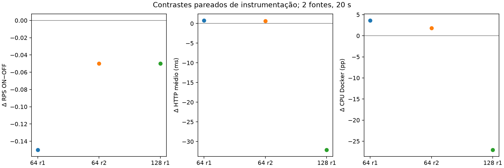
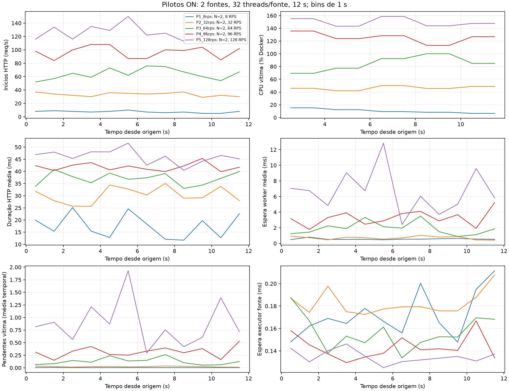
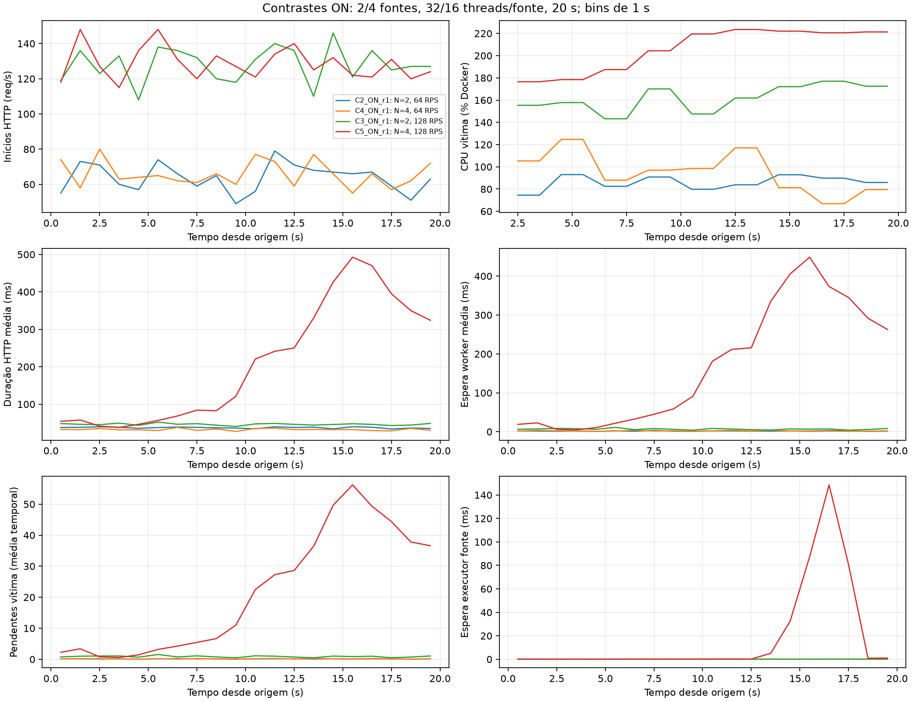

# Caracterização operacional offline do tráfego legítimo

## A. Resumo executivo

Foram reanalisadas 16 execuções recentes da campanha de 04/11/2026: cinco pilotos de 12 s e onze execuções principais de 20 s. Configurações efetivas, IDs, inventários de fontes, imagem/limites da vítima, requisições, métricas e eventos foram lidos diretamente. Todas utilizam direct, uma vítima, `/medium`, dois workers, capacidade fixa, sem autoscaling/balanceamento e orçamento agregado de 64 threads. Nenhuma carga definitiva é selecionada.

Até 64 RPS há evidência favorável de operação regular no intervalo observado. O piloto de 96 RPS também não apresentou degradação importante, mas não tem repetição. A condição de 128 RPS com duas fontes teve maior espera, ainda sem falhas; com quatro fontes houve acúmulo prolongado de trabalho, alta duração HTTP e atraso secundário nos geradores. Isso não mede capacidade máxima nem demonstra saturação permanente.

Todos os logs de requisições das 16 execuções terminaram sem falhas e sem tentativas abertas. Os relatórios de captura registram zero perdas de kernel e as verificações preservadas aceitam as cinco features. Essas verificações foram inspecionadas, não reexecutadas. Diagnóstico OFF não é preenchido com zero.

## B. Inventário das execuções

| Execução | N × RPS/fonte | s | Seed | Grupo | Última conclusão (s) |
|---|---|---|---|---|---|
| C1_ON_r1 | 2 × 4 | 20.00 | 44112101 | A | 20.00 |
| C1_ON_r2 | 2 × 4 | 20.00 | 44112102 | A | 20.02 |
| C2_OFF_r1 | 2 × 32 | 20.00 | 44112101 | A | 20.06 |
| C2_OFF_r2 | 2 × 32 | 20.00 | 44112102 | A | 20.05 |
| C2_ON_r1 | 2 × 32 | 20.00 | 44112101 | A | 20.04 |
| C2_ON_r2 | 2 × 32 | 20.00 | 44112102 | A | 20.04 |
| C3_OFF_r1 | 2 × 64 | 20.00 | 44112101 | B | 20.09 |
| C3_ON_r1 | 2 × 64 | 20.00 | 44112101 | B | 20.05 |
| C4_ON_r1 | 4 × 16 | 20.00 | 44112101 | A | 20.05 |
| C4_ON_r2 | 4 × 16 | 20.00 | 44112102 | A | 20.05 |
| C5_ON_r1 | 4 × 32 | 20.00 | 44112101 | B | 20.20 |
| P1_8rps | 2 × 4 | 12.00 | 44112001 | B | 11.94 |
| P2_32rps | 2 × 16 | 12.00 | 44112002 | B | 12.01 |
| P3_64rps | 2 × 32 | 12.00 | 44112003 | B | 12.02 |
| P4_96rps | 2 × 48 | 12.00 | 44112004 | B | 12.05 |
| P5_128rps | 2 × 64 | 12.00 | 44112005 | B | 12.06 |

O inventário completo está em [runs_inventory.csv](runs_inventory.csv), incluindo run_id, caminho original, configuração, threads, seed, encerramento, perdas de captura, imagem e limites. Todos os caminhos referem-se a `experiment_results/capacity-exploration-20261104/<execução>/`.

Grupo A: repetições equivalentes dentro da mesma chave de configuração: C1 ON, C2 ON, C2 OFF e C4 ON, duas cada. Grupo B: pilotos e condições de uma única repetição; permitem contrastes descritivos, sem DP entre repetições. Mesmo nos grupos A, contrastar fontes, duração ou modo exige ressalvas. Grupo C: campanhas históricas com proxy e outras cargas, como scientific-reduced-clock-r2, permanecem apenas contexto e não foram reunidas aos dados recentes. O inventário não pretende catalogar toda execução legítima de arquiteturas antigas.

Os cinco pilotos usam seeds 44112001–44112005, em ordem crescente de taxa; as principais r1/r2 usam 44112101/44112102. Mesmo seed não garante sequência efetiva idêntica entre diferentes distribuições. C3_ON_r2, C3_OFF_r2 e C5_ON_r2 não foram executados após o gate exploratório; não são repetições ausentes por falha HTTP. O relatório histórico registra HEAD 74d70b9 no contexto da campanha; não foi localizado vínculo inequívoco de commit por execução nos metadados inspecionados, e esse valor não foi inventado no inventário. O HEAD da análise consta no manifesto novo.

## C. Estatísticas por execução

| Execução | RPS efetivo | n HTTP | HTTP média ± DP (ms) | Mediana/p95 (ms) | CPU Docker % | Espera média/p95 (ms) |
|---|---|---|---|---|---|---|
| C1_ON_r1 | 8.70 | 174 | 18.46 ± 12.46 | 14.57 / 52.23 | 12.18 | 0.54 / 0.67 |
| C1_ON_r2 | 8.25 | 165 | 21.10 ± 14.93 | 15.69 / 56.50 | 9.35 | 0.54 / 0.61 |
| C2_OFF_r1 | 63.95 | 1280 | 36.75 ± 20.10 | 51.51 / 59.34 | 82.26 | — / — |
| C2_OFF_r2 | 61.40 | 1229 | 35.64 ± 20.01 | 51.36 / 57.94 | 78.28 | — / — |
| C2_ON_r1 | 63.80 | 1276 | 37.53 ± 20.08 | 52.01 / 59.56 | 85.90 | 1.92 / 9.78 |
| C2_ON_r2 | 61.35 | 1227 | 36.26 ± 20.10 | 51.54 / 58.58 | 80.06 | 1.74 / 9.79 |
| C3_OFF_r1 | 128.15 | 2564 | 78.62 ± 58.44 | 62.14 / 227.07 | 189.00 | — / — |
| C3_ON_r1 | 128.10 | 2562 | 46.51 ± 19.29 | 54.05 / 71.44 | 161.95 | 6.91 / 23.28 |
| C4_ON_r1 | 65.85 | 1318 | 32.41 ± 20.05 | 19.54 / 60.44 | 95.35 | 2.27 / 11.25 |
| C4_ON_r2 | 60.85 | 1218 | 31.83 ± 19.78 | 18.97 / 59.65 | 87.45 | 2.17 / 11.32 |
| C5_ON_r1 | 128.65 | 2574 | 206.55 ± 159.63 | 163.44 / 488.47 | 205.99 | 166.82 / 433.43 |
| P1_8rps | 7.33 | 88 | 17.94 ± 13.43 | 12.27 / 54.29 | 10.29 | 0.56 / 0.73 |
| P2_32rps | 33.42 | 401 | 30.46 ± 19.75 | 17.13 / 57.13 | 46.47 | 0.71 / 1.35 |
| P3_64rps | 63.92 | 767 | 37.20 ± 19.90 | 51.85 / 59.34 | 84.84 | 1.99 / 9.76 |
| P4_96rps | 96.83 | 1162 | 41.92 ± 19.60 | 52.90 / 63.21 | 125.56 | 3.29 / 13.72 |
| P5_128rps | 127.50 | 1530 | 46.34 ± 19.37 | 53.91 / 71.33 | 149.71 | 6.86 / 21.87 |

Valores completos em [per_run_statistics.csv](per_run_statistics.csv): n válido, média, DP amostral, mediana, p95, extremos e ausências quando definíveis. HTTP inclui todas as tentativas com duração registrada, inclusive cauda. RPS considera starts em `[0,T)`; conclusões/s na mesma janela e última conclusão ficam no inventário. A diferença entre starts e conclusões dentro da janela pode ser drenagem, não perda.

CPU Docker é média dos ticks com suporte, incluindo ticks observados fora da geração quando presentes. Não é média temporal exata. Pendências, handlers e workers usam médias ponderadas pelo tempo apenas em `[0,T)`. Percentil: posto mais próximo `ceil(0,95n)`; DP amostral usa n−1. Os números de observações são contagens reais, não valores escalados junto com unidades.

## D. Estatísticas entre repetições

| Configuração (N, taxa/fonte, duração, modo) | n | Indicador | Média entre runs | DP entre runs |
|---|---|---|---|---|
| N2_rate4_T20_ON | 2.00 | http_duration/mean | 19.78 | 1.87 |
| N2_rate4_T20_ON | 2.00 | cpu_docker/mean | 10.77 | 2.00 |
| N2_rate4_T20_ON | 2.00 | starts_1s/mean | 8.47 | 0.32 |
| N2_rate4_T20_ON | 2.00 | worker_wait/mean | 0.54 | 0.01 |
| N2_rate32_T20_OFF | 2.00 | http_duration/mean | 36.19 | 0.78 |
| N2_rate32_T20_OFF | 2.00 | cpu_docker/mean | 80.27 | 2.82 |
| N2_rate32_T20_OFF | 2.00 | starts_1s/mean | 62.67 | 1.80 |
| N2_rate32_T20_ON | 2.00 | http_duration/mean | 36.89 | 0.90 |
| N2_rate32_T20_ON | 2.00 | cpu_docker/mean | 82.98 | 4.12 |
| N2_rate32_T20_ON | 2.00 | starts_1s/mean | 62.58 | 1.73 |
| N2_rate32_T20_ON | 2.00 | worker_wait/mean | 1.83 | 0.13 |
| N4_rate16_T20_ON | 2.00 | http_duration/mean | 32.12 | 0.42 |
| N4_rate16_T20_ON | 2.00 | cpu_docker/mean | 91.40 | 5.58 |
| N4_rate16_T20_ON | 2.00 | starts_1s/mean | 63.35 | 3.54 |
| N4_rate16_T20_ON | 2.00 | worker_wait/mean | 2.22 | 0.07 |

O arquivo [configuration_summary.csv](configuration_summary.csv) resume cada estatística por execução. Uma média de p95 por execução é rotulada como tal; não é p95 de amostras reunidas. Duas repetições permitem calcular DP entre runs, mas não caracterizar bem sua distribuição. Para n=1 o DP entre runs permanece ausente.

## E. Comparação entre configurações

### Taxa agregada

Os pilotos controlam N=2, 32 threads/fonte e duração de 12 s. À medida que a taxa nominal passa por 8, 32, 64, 96 e 128 RPS, CPU e ocupação crescem. Os starts efetivos são aproximadamente 7,33; 33,42; 63,92; 96,83 e 127,50/s. São realizações curtas com seeds distintas, não uma curva de capacidade replicada. O desvio relativo maior em 8 RPS é compatível com pequena contagem; não comprova limitação do executor.

### Mesma taxa, duas/quatro fontes

A 64 RPS, C2 ON versus C4 ON representa 2×32 com 32 threads/fonte versus 4×16 com 16 threads/fonte. As médias HTTP são cerca de 36–38 versus 32 ms, mas os p95 ficam próximos de 59–60 ms. Espera p95 aumenta modestamente de ~9,8 para ~11,3 ms; CPU/op também difere (~11,9–12,2 versus ~12,5–12,7 ms). A amostra não permite atribuir esses contrastes exclusivamente ao número de fontes.

A 128 RPS, C3 ON versus C5 ON muda 2×64 para 4×32 e reduz a quota por fonte. HTTP médio passa de ~46,5 para ~206,5 ms e espera média de ~6,9 para ~166,8 ms. CPU/op passa de ~11,37 para ~14,65 ms. O contraste é entre configurações completas, uma execução de cada; fontes, quotas e estado operacional não foram isolados.

### ON/OFF

A 64 RPS, ON−OFF aumenta HTTP médio em ~0,78 e ~0,62 ms e CPU Docker em ~3,64 e ~1,79 pontos percentuais. As diferenças de RPS são pequenas. A 128 RPS o OFF tem HTTP médio maior em ~32,1 ms que o ON; uma repetição não identifica overhead. Não há estimativa causal de instrumentação nem prova de overhead nulo.

## F. Análise temporal

As linhas são bins descritivos de 1 s; não repetições. HTTP é atribuído à conclusão, espera worker à submissão, CPU/op ao início computacional e atraso da fonte ao início da tarefa. Os relógios diagnósticos são utilizados somente após verificar os certificados de comparabilidade existentes. Brackets previamente auditados de até ~50–62 ms limitam ordenação fina perto de fronteiras.

Nas condições de 64 RPS não se observa a tendência prolongada de crescimento de filas que caracteriza C5. Em C5, a espera e as pendências aumentam aproximadamente entre 7–9 s, chegam ao máximo por volta de 14–16 s e recuam parcialmente antes do fim. O pico não representa uma divergência indefinida: todas as tentativas drenam. O fim da janela de geração não é o fim de toda atividade.

## G. Interpretação operacional

O gerador faz primeiro despacho imediato e depois esperas exponenciais relativas. Planejar o próximo despacho, submetê-lo, obter thread, iniciar HTTP e concluir são eventos distintos. Bookkeeping, espera e agendamento não são compensados por uma agenda absoluta. Portanto, o processo efetivo não foi certificado como Poisson homogêneo exato.

Nos runs ON regulares, o p95 submit→task é submilissegundo. C5 apresenta média ~17,36 ms e p95 ~145,68 ms, embora a taxa total permaneça próxima da nominal. Há fila antes do HTTP; cumprir o total agregado não garante cumprir os instantes planejados. O atraso de fontes cresce tardiamente na execução, depois da elevação de espera na vítima observada anteriormente. Isso é compatível com tarefas HTTP longas ocupando threads, sem provar direção causal. [source_statistics.csv](source_statistics.csv) preserva diferenças por fonte; picos simultâneos agregados são reconstruídos por intervalos, não pela soma de máximos não coincidentes.

Espera worker é submit→início e inclui fila, IPC e agendamento; não é CPU. CPU/op mede process_time no worker; duração de parede mede início→fim. CPU Docker usa `ΔCPU_contêiner/ΔCPU_sistema × CPUs_online ×100`; 80% representa cerca de 0,8 núcleo equivalente. Não representa 80% do pool de dois workers. O host tinha 12 CPUs lógicas segundo a evidência anterior; limites registrados da vítima são sem quota/cpuset. CPU do contêiner inclui outros custos além das operações.

Em C3/C5, a ocupação média estimada é ~1,46/~1,87 de dois workers. C5 mantém ambos quase continuamente ocupados no período de maior fila e chega a dezenas de operações aguardando início. A diferença de HTTP acompanha principalmente a espera; CPU/op também aumenta, mas em escala muito menor. Nenhuma dessas associações determina por que o custo mudou ou demonstra que quatro fontes causaram a degradação.

## H. Considerações estatísticas

DP das durações descreve heterogeneidade entre tentativas. DP dos starts de 1 s descreve variabilidade temporal. DP entre runs descreve repetição da configuração. Esses denominadores não são intercambiáveis. Médias de ocupação são integrais de sobreposição divididas pelo tempo, sem DP fictício entre operações.

Não foram calculados ICs. Futuros ICs poderiam acrescentar valor para HTTP médio, espera média e diferenças ON/OFF ou N=2/N=4, usando execuções como unidades e pareamento quando justificado. As condições C1/C2/C4 têm somente n=2 equivalentes: suficientes para DP descritivo, frágeis para IC útil. Os pilotos e condições de 128 têm n=1 por configuração e não sustentam incerteza entre repetições. Média/DP/amplitude são suficientes para esta exploração.

Com novas repetições independentes e premissas razoáveis, IC t para média por execução ou para diferenças pareadas seria uma opção simples. Normalidade aproximada das médias/diferenças, independência e amostra devem ser justificadas; janelas consecutivas não aumentam artificialmente n. Não se propõe bootstrap ou método avançado. Essa questão é distinta dos ICs da avaliação dos detectores.

## I. Lacunas identificadas

32 e 96 RPS têm apenas um piloto; 128 tem uma execução por distribuição/modo. Nenhuma execução recente dura vários minutos. OFF não permite reconstruir espera ou CPU/op e os contadores diagnósticos ausentes não são zero. A mudança N=2→4 altera a quota local. Não há identificação causal de frequência/escalonamento/interferência. O vínculo por execução com commit é incompleto na evidência inspecionada. A integridade publicada não foi recertificada integralmente por hashes de todos os datasets; o novo manifesto identifica os inputs efetivamente lidos.

## J. Proposta de complementação

**Necessário agora:** nenhum experimento para sustentar as conclusões exploratórias acima. A análise existente basta para manter candidatas e identificar limitações.

**Antes da campanha científica, dependente do desenho final (prioridade alta):** confirmar estabilidade da configuração legítima escolhida no horizonte científico. Proposta preliminar: três execuções legítimas independentes da única configuração finalista, com duração nominal igual à futura execução científica e drenagem até o limite previamente definido; 390 s apenas se esse horizonte histórico for mantido. Coletar logs científicos, captura, recursos, estados finais e diagnóstico suficiente para fila/espera. Isso responde à estabilidade sustentada que 12–20 s não avaliam. Três é uma verificação mínima preliminar, não tamanho amostral definitivo para inferência. Pode integrar os primeiros controles/baseline se critérios forem definidos antes da coleta.

**Opcional:** se a decisão continuar especificamente entre 32 e 64 RPS, três execuções equivalentes por carga, mesmo N e quota, no horizonte aprovado. Pode adiar até a escolha dos ataques; executar somente se a decisão não puder ser resolvida pela validação da finalista. Não há justificativa para repetir toda a matriz 8–128 ou aprofundar C5 agora.

## K. Contribuição para o protocolo científico

8–64 RPS têm evidências favoráveis de operação regular no intervalo observado; 32 tem menos evidências de repetibilidade que 64. 96 e 128×duas fontes permanecem evidência limitada. 128×quatro fontes exige tratar a fila observada como parte da condição, não como referência legítima estável presumida. A escolha final depende de representatividade, folga e mecanismos ofensivos; nenhum número de fontes ou taxa é fixado aqui.

### Rastreabilidade e reprodução

Script [analyze.py](analyze.py); comando a partir da raiz: `PYTHONPATH=. .venv/bin/python -B reports/legitimate_characterization_20261105/analyze.py`. Ele lê apenas a campanha recente e grava exclusivamente neste diretório. [analysis_manifest.json](analysis_manifest.json) registra HEAD e SHA-256 dos arquivos lidos. [timeline_1s.csv](timeline_1s.csv) permite reproduzir as figuras e examinar amostras vazias. Inputs são logs e configurações originais, não tabelas históricas agregadas. Não houve experimento, tráfego, inicialização Docker, alteração de features, detector, autoridade, dataset ou arquivo histórico.
